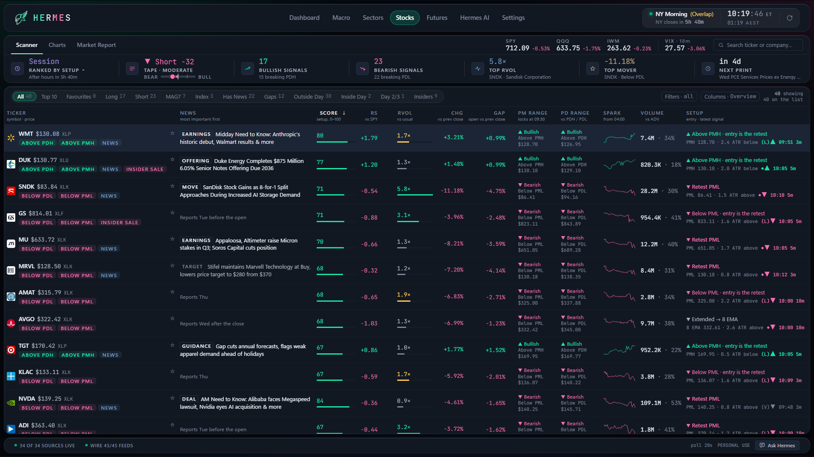
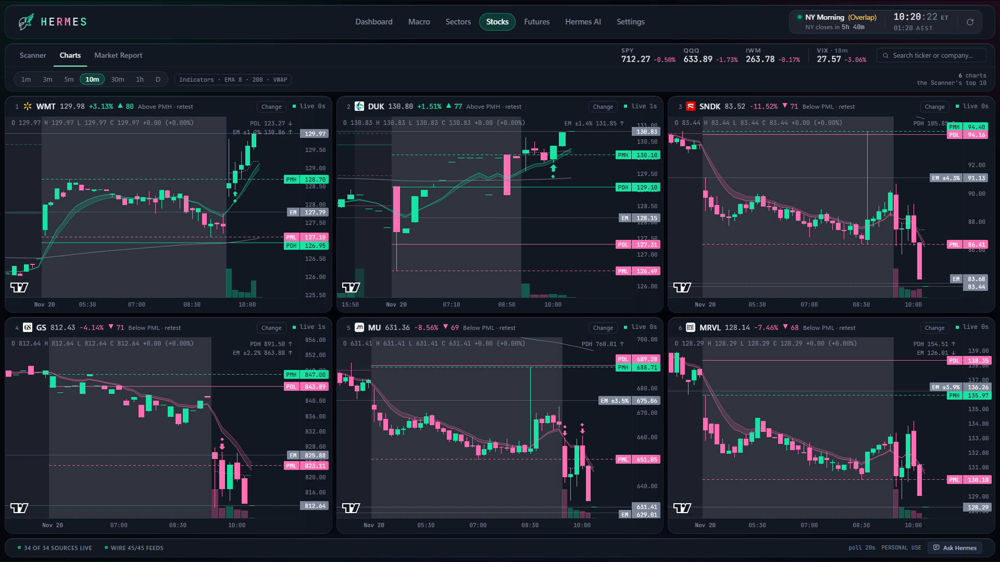
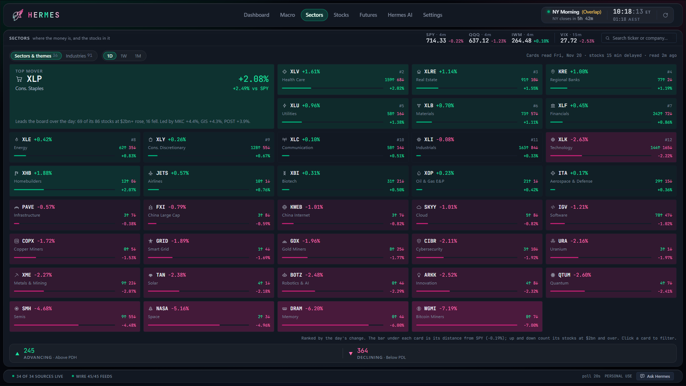
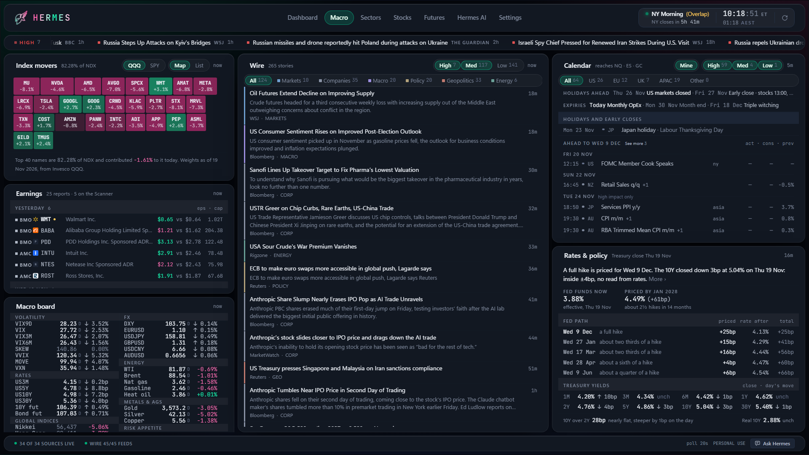
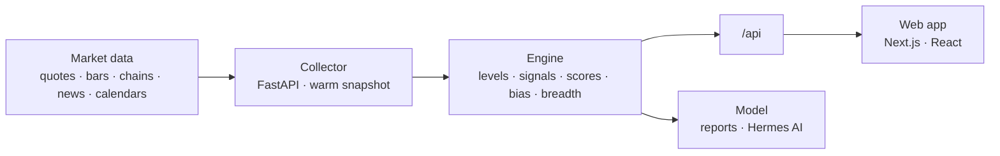

<div align="center">
  
  <h1>Hermes</h1>
  <p><strong>A trading terminal for the New York session.</strong></p>
  <p>A live, ranked scanner of US stocks built on a break-and-retest strategy, with the futures,<br />macro and news context around it and an AI analyst that reads the whole desk.</p>
  <p>
    
    
    
    
    
    
    
  </p>
  <p>
    <a href="#the-stocks-scanner">Scanner</a> ·
    <a href="#the-rest-of-the-desk">The desk</a> ·
    <a href="#how-it-works">How it works</a> ·
    <a href="#getting-started">Getting started</a> ·
    <a href="#limitations">Limitations</a>
  </p>
</div>



## Overview

Hermes is a single-user market terminal for day-trading the New York session: US stocks, usually through options, and the index, metals and energy futures around them. A local collector gathers free market data, an engine computes every level, signal, score and bias itself, and a web app lays the session out across six pages.

It answers four questions, in the order a trader asks them:

| Question | Answered by |
|---|---|
| **What should I trade right now?** | The Stocks scanner, ranked for the hour |
| **Which way is the market leaning?** | Bias, breadth and sector rotation |
| **What can move it today?** | The calendar, the Fed, earnings, options expiries and the news wire |
| **Why?** | Hermes AI, answering from the figures on screen |

Language models do two jobs only: writing the market reports and answering questions. Both work from figures the engine computed, and every number they write is checked against them.

## The Stocks scanner

The scanner is the centre of the terminal; every other page exists to give its setups context. It is a TradingView (Pine) break-and-retest strategy, ported to run across the market instead of one chart at a time.

### How a setup is found

Every stock carries four levels: the pre-market high and low (PMH, PML) and the previous day's high and low (PDH, PDL). A setup is a break of one of them, and the entry is the retest. The side comes from the levels alone: above the highs is a long, below the lows a short.

| Signal | Entry |
|---|---|
| **(L)** Level | The retest of the level that broke |
| **(E)** EMA | The retest of the 8-EMA wave, once price has run more than 2.5 ten-minute ATRs past the level |
| **(V)** VWAP | The retest of VWAP, on the same extended runs |

Signals print on the 3, 5 and 10-minute charts. A setup raises one alert, from the first chart to print it, on whichever page is open.

### How the list is ranked

There is one list, and what it ranks by changes with the clock (ET):

| When | The list shows | Ranked by |
|---|---|---|
| Pre-market | The names in play going into the open | Gap in daily ATRs, pre-market volume, reports and fresh news |
| Session | The session's setups, from the bell | The setup score below |
| After&nbsp;hours | What is moving after the close, and the day's big movers | The size of the move, volume and news |
| Overnight | The evening's movers and the reports due before the next open | The same |

During the session the list rotates: each minute, names off the list that are through their levels are scored the same way and swapped in for its weakest picks. The index funds, the MAG 7 and your favourites always stay.

The setup score is 0 to 100, the sum of six parts less any penalties:

| Part | Points | Earned by |
|---|---:|---|
| Entry | 25 | A setup with an entry to take or to wait for, on the right side of VWAP; all or nothing |
| Structure | 20 | Through both the pre-market and previous-day level (20), through one (12), or approaching (7) |
| Catalyst | 20 | Earnings, news and filings read for direction; a story against the trade costs points |
| Market | 15 | The market's bias (11) and the stock's sector (4) on the trade's side |
| RS&nbsp;vs&nbsp;SPY | 10 | The move against SPY in daily ATRs, paid in full only at a live entry |
| Relative&nbsp;volume | 8 | Volume so far against the same time of day; before the bell, the gap and pre-market volume instead |
| Penalties | − | Illiquid options, a daily range already used, a release within 30 minutes, earnings after the close, a failed break |

The score is a heuristic rank, not a probability. Every signal is logged with its outcome, and each name's score card shows how past signals like it have played out.

### What is on screen

- **Every row in one line.** Level state, relative strength, relative volume, change and gap with the pre-market and after-hours moves, a sparkline, the setup with its latest signal, the most important headline with its catalyst type, insider trades and the score.
- **Filters as chips.** Top 10, Favourites, Long, Short, MAG 7, Index, Has News, Gaps, Outside Day, Inside Day, Day 2/3 and Insiders. Market cap, relative volume and sector sit behind one Filters menu, with Overview, Levels and Options column sets.
- **A full read in the slide-out.** A live chart from 1 minute to daily (EMA 8, 20, 50 and 200, VWAP with deviation bands, the four levels, the expected move and the gamma walls), the session snapshot, live level states, the score's parts, the record of similar signals, news and the options read.
- **Options from the chain.** Implied volatility and IV rank, the straddle's expected move, term structure, skew, liquidity, open-interest flow and suggested contracts, from Cboe's delayed chains.
- **Charts and a written brief.** The Charts view puts the top names on six live charts under one toolbar. The Market Report view is a briefing on SPY, QQQ and IWM for New York.

<table>
  <tr>
    <td width="50%"></td>
    <td width="50%"></td>
  </tr>
  <tr>
    <td valign="top"><sub><b>Slide-out.</b> The chart with the strategy's levels, the session snapshot, live level states and the score's parts.</sub></td>
    <td valign="top"><sub><b>Charts.</b> The list's top names on six live charts, one toolbar for all of them.</sub></td>
  </tr>
</table>

## The rest of the desk

<table>
  <tr>
    <td width="50%"></td>
    <td width="50%"></td>
  </tr>
  <tr>
    <td valign="top"><sub><b>Dashboard.</b> The session on one page: the game plan (market bias, focus sectors and themes, the day's reports, the next release and options expiry), breadth across every US stock at $2bn and up, the futures at a glance, the scanner's top ten, high-impact and stock news in one card, the Market Pulse and sector rotation.</sub></td>
    <td valign="top"><sub><b>Sectors.</b> The 11 sector and 25 theme funds as heat cards (day, week and month, with the pre-market move before the bell), 91 industries, and every $2bn+ stock in a chosen group with its levels and news.</sub></td>
  </tr>
  <tr>
    <td width="50%"></td>
    <td width="50%"></td>
  </tr>
  <tr>
    <td valign="top"><sub><b>Futures.</b> NQ, ES, gold, silver and crude: price, bias from a weighted driver board, dealer gamma, a trend-or-range read for New York, level state and the next release, with session ranges, volume profile, gamma levels and a live chart.</sub></td>
    <td valign="top"><sub><b>Market Report.</b> A briefing per contract and session: the bottom line, the bias by factor, the key levels and what can move prices, written by a model from the engine's figures.</sub></td>
  </tr>
  <tr>
    <td width="50%"></td>
    <td width="50%"></td>
  </tr>
  <tr>
    <td valign="top"><sub><b>Macro.</b> A news wire from about 45 publisher feeds, classified by desk and impact; the economic calendar with the agencies' own figures; the Fed and Treasury diary, holidays and expiries; index movers, earnings, the macro board and the rates path.</sub></td>
    <td valign="top"><sub><b>Hermes AI.</b> A chat that reads the whole desk through tools, with every figure it quotes checked against live data. It is also a side panel on every page.</sub></td>
  </tr>
</table>

**Market Pulse**, on the Dashboard and as a view of Macro's board, reads stocks, bonds, the dollar, gold, silver, oil and bitcoin against each other: a fear-to-greed scale of the day's risk appetite, each market's move sized in its own usual day, and the pattern they make together (risk-on, risk-off, a rates shock, forced selling, or none). It is context for the day, not a signal: it feeds neither the bias nor the score.

**Settings** holds three interfaces (Quiet, Luminous Glass and a sidebar layout), chart colour presets, signal alerts by desktop notification and sound, and the live price feed.

## How it works

A Python collector polls each source on its own cadence into one warm, in-memory snapshot, so no page waits on a fetch. The engine builds each page from that snapshot when it is asked for. The Next.js app proxies the collector and polls it, faster during the session. There is no database: state is the snapshot plus a file cache.



**Stack.** Next.js 15, React 19, TypeScript, Tailwind CSS 4 and Lightweight Charts on the front end; Python 3.11 and FastAPI for the collector and engine.

| Source | Used for |
|---|---|
| Yahoo Finance | Quotes, 5-minute and daily bars, the live trade stream, per-name headlines |
| Webull OpenAPI *(optional)* | Real-time trades and snapshots for the tracked names, from your own account |
| TradingView (public endpoints) | The market-wide read of every US stock at $300m+, company news, stand-in calendars |
| Cboe | Delayed option chains |
| SEC EDGAR | Filings, Form 4 insider trades and past report dates |
| BLS, Census Bureau, BEA, EIA | The agencies' own figures for the US releases |
| U.S. Treasury, Federal Reserve, TreasuryDirect | Yields, the FOMC and Fed speakers, coupon auctions |
| Nasdaq | Economic and earnings calendars (TradingView stands in when it is unavailable) |
| Publisher RSS | The news wire |
| iShares and fund holdings | Index weights and theme fund members |
| GEXYGEN *(optional companion service)* | Dealer gamma levels |
| OpenRouter *(optional)* | The market reports and Hermes AI |

<details>
<summary><b>Project layout</b></summary>

```
src/app/              Next.js routes; /api/* proxies the collector
src/components/       The pages and their panels
src/lib/              Front-end logic, each module with its tests beside it
server/newsterminal/  The collector, the engine and the API
  sources/            One module per data source
server/tests/         The pytest suite
server/tools/         Probes, and the scripts that read the signal records
scripts/              Logos, the icon and the desktop shortcut
dev.ps1               The launcher
```

</details>

## Getting started

Requires Windows 10 or 11, Node.js 20+ and Python 3.11+. Windows Terminal is recommended: the services open as tabs in one window.

```powershell
npm install
copy .env.example .env.local   # optional: add keys (below)
.\dev.ps1                      # starts the collector and the web app, then opens the browser
```

The web app runs on **http://localhost:3100** and the collector on **http://127.0.0.1:8100**. The collector creates its own Python environment on first run. Nothing else is required: every key is optional, and a feature without its key says so on screen.

| Variable | Enables |
|---|---|
| `OPENROUTER_API_KEY` | The market reports and Hermes AI. `NT_REPORT_MODEL`, `NT_CHAT_MODEL` and `NT_HERMES_MODEL` pick the models |
| `WEBULL_APP_KEY`, `WEBULL_APP_SECRET` | Real-time trades from a Webull account. `NT_PRICE_FEED` picks the feed, as does Settings |
| `NT_GEXYGEN_API` | The gamma levels service; set it empty to turn the panels off |

Every other setting (ports, polling cadences, the cache directory) has a working default and is documented in [`.env.example`](.env.example).

| Command | What it does |
|---|---|
| `.\dev.ps1` | Starts whatever is not already running, then opens the browser |
| `.\dev.ps1 -Restart` | Restarts the collector in place; this is how Python changes go live |
| `.\dev.ps1 -Prod` | Serves a production build of the web app |
| `.\dev.ps1 -CollectorOnly` | Runs the collector alone |
| `npm run shortcut` | Adds a desktop launcher |

`-NoBrowser`, `-NoGexygen`, `-Windows` (a window per service) and `-Force` are also accepted.

## Development

```powershell
npm run check   # TypeScript, ESLint, Ruff, mypy and pytest
npm test        # front-end unit tests
```

About 2,300 Python tests and 200 TypeScript tests. Most are pinned to a real case the terminal once got wrong: a clock boundary, a feed's quirk, a stock split.

## Limitations

- **Personal use only.** The data sources are free feeds that are not redistributable. The code is published; anyone deploying it for others must replace the sources with licensed ones.
- **Not financial advice.** Hermes is a research tool for one desk. Nothing it shows is a recommendation to trade.
- **Delayed where free.** The market-wide read and the option chains are 15 minutes delayed and futures quotes about 10. Tracked names trade live through the stream, or through Webull when it is configured.
- **Scores and bias are judgement.** The score is a heuristic rank and the bias weights are set by hand; both are logged against outcomes so they can be tested.
- **Volume profiles are approximate**, built from 5-minute bars.
- **Unofficial endpoints can change.** Each source reports its own health on the status rail, and the terminal degrades one panel at a time.
- **Desktop and Windows first.** Built for wide screens (1280px and up), with PowerShell launch scripts.
