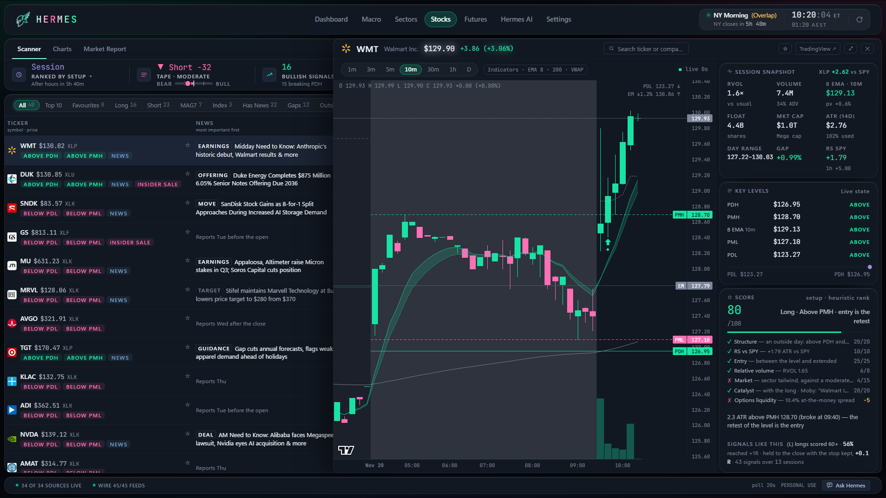
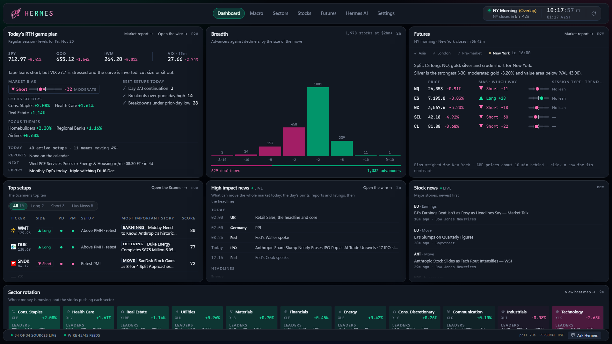
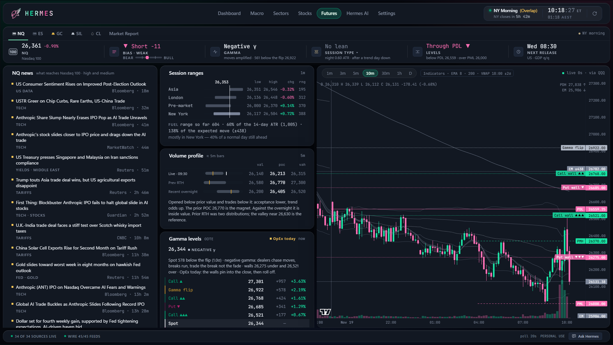
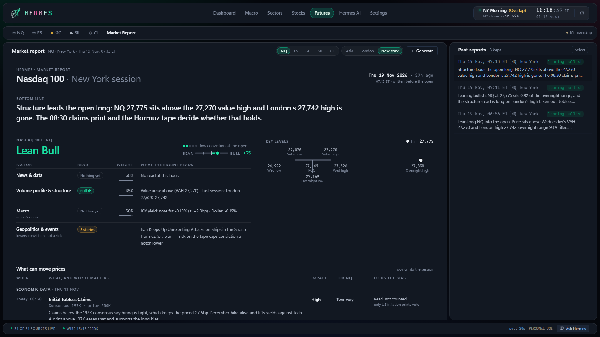
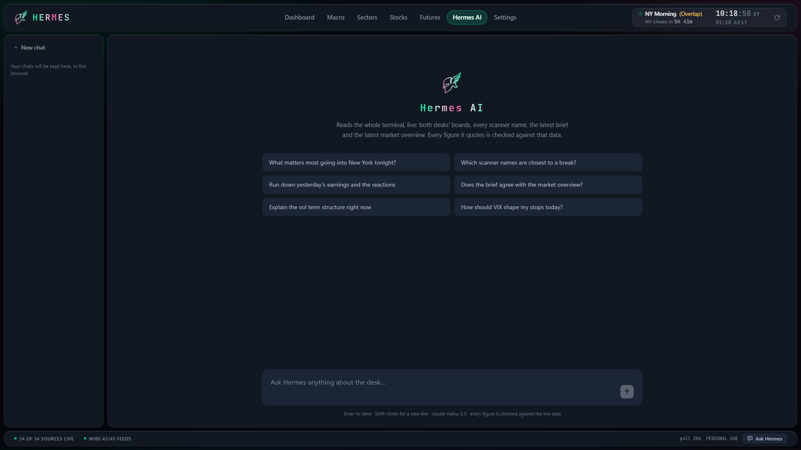
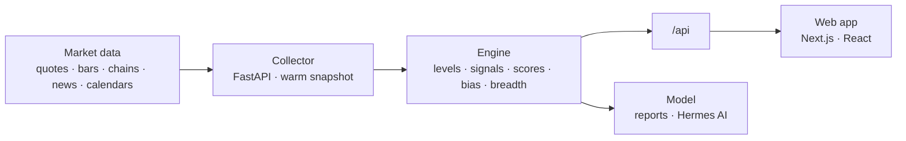

<div align="center">
  
  <h1>Hermes</h1>
  <p><strong>A trading terminal for the New York session.</strong><br />
  A live, ranked scanner of US stocks built on a break-and-retest strategy, the futures, macro and news context around it, and an AI analyst that reads the whole desk.</p>
  <p>
    
    
    
    
    
    
    
  </p>
</div>


## Overview

Hermes is a single-user market terminal for day-trading the New York session: US stocks, mostly traded through options, and the index, metals and energy futures around them. A local collector gathers free market data, an engine computes every level, signal, score and bias itself, and a web front end lays the session out across six pages.

It is built to answer four questions quickly, in the order a trader asks them:

1. **What should I trade right now?** The Stocks scanner, ranked for the hour.
2. **Which way is the market leaning?** The bias, breadth and sector rotation.
3. **What can move it today?** The calendar, the Fed, earnings, options expiries and the news wire.
4. **Why?** Hermes AI, which answers from the same figures that are on screen.

Language models do two jobs only: writing the market reports and answering questions. Both work from figures the engine computed, and every number they write is checked against them.

## The Stocks scanner

The scanner is the centre of the terminal. Everything else on the desk exists to give its setups context.

- **One list, ranked for the hour.** After the close it shows the evening's movers; before the open, the names in play by gap, pre-market volume and news; from the bell, the session's setups by score. During the session it rotates, swapping in better setups from the wider market every minute.
- **A TradingView strategy, ported.** The engine runs a break-and-retest Pine script: a break of the pre-market or previous-day high or low (PMH, PML, PDH, PDL), then the retest of that level, or of VWAP and the 8-EMA wave once price has run too far. Signals fire on the 3, 5 and 10-minute charts, with one alert per setup on every page.
- **Every row in one line.** Level state, relative strength against SPY, relative volume, change and gap with the pre-market and after-hours moves, a sparkline, the setup and its latest signal, the most important headline with its catalyst type, insider trades, and a 0–100 score with its breakdown.
- **Filters as chips.** Top 10, Favourites, Long, Short, MAG 7, Index, Has News, Gaps, Outside Day, Inside Day, Day 2/3 and Insiders, with market cap, relative volume and sector behind one Filters menu, and Overview, Levels and Options column sets.
- **A full read in the slide-out.** Any name opens a live chart (1 minute to daily; EMA 8, 20, 50 and 200; VWAP with deviation bands; the four levels, the expected move and the gamma walls), its session snapshot, live level states, the score's parts, how past signals like it have played out, its news and its options read.
- **Options from the chain.** Cboe's delayed chains give each name its implied volatility and IV rank, the straddle's expected move, term structure, skew, liquidity, open-interest flow and suggested contracts.
- **Charts and a written brief.** A Charts view puts the top names on six live charts with one shared toolbar, and the Market Report view is a briefing on SPY, QQQ and IWM for New York.

<table>
  <tr>
    <td width="50%"></td>
    <td width="50%"></td>
  </tr>
  <tr>
    <td><sub><b>Slide-out.</b> The chart with the strategy's levels, the session snapshot, live level states and the score's parts.</sub></td>
    <td><sub><b>Charts.</b> The list's top names on six live charts, one toolbar for all of them.</sub></td>
  </tr>
</table>

## The rest of the desk

<table>
  <tr>
    <td width="50%"></td>
    <td width="50%"></td>
  </tr>
  <tr>
    <td valign="top"><sub><b>Dashboard.</b> The session on one page: the game plan (market bias, focus sectors and themes, the day's reports, the next release and options expiry), breadth across every US stock at $2bn+, the futures at a glance, the scanner's top ten, high-impact news, stock news and sector rotation. Every card shows how recently it was updated.</sub></td>
    <td valign="top"><sub><b>Sectors.</b> The 11 sector and 25 theme funds as heat cards (day, week and month; the pre-market move before the bell), 91 industries, and every $2bn+ stock in a chosen group with its levels and news.</sub></td>
  </tr>
  <tr>
    <td width="50%"></td>
    <td width="50%"></td>
  </tr>
  <tr>
    <td valign="top"><sub><b>Futures.</b> NQ, ES, gold, silver and crude: price, bias from a weighted driver board, dealer gamma, a trend-or-range read for New York, level state and the next release, with session ranges, volume profile, gamma levels and a live chart.</sub></td>
    <td valign="top"><sub><b>Market Report.</b> A briefing per contract and session: the bottom line, the bias by factor, the key levels and what can move prices, written by a model from the engine's figures.</sub></td>
  </tr>
  <tr>
    <td width="50%"></td>
    <td width="50%"></td>
  </tr>
  <tr>
    <td valign="top"><sub><b>Macro.</b> A news wire from about 45 publisher feeds, classified by desk and impact; the economic calendar with the agencies' own figures; the Fed and Treasury diary, holidays and expiries; index movers, earnings, the macro board and the rates path.</sub></td>
    <td valign="top"><sub><b>Hermes AI.</b> A chat that reads the whole desk through tools, with every figure it quotes checked against live data. It is also a side panel on every page.</sub></td>
  </tr>
</table>

## How it works

A Python collector polls each source on its own cadence into one warm, in-memory snapshot, so no page ever waits on a fetch. The engine builds each page from that snapshot when it is asked for. The Next.js front end proxies the collector and polls it, faster during the session.



| Source | Used for |
|---|---|
| Yahoo Finance | Quotes, 5-minute and daily bars, the live trade stream, per-name headlines |
| Webull OpenAPI *(optional)* | Real-time trades and snapshots for the tracked names, from your own account |
| TradingView (public endpoints) | The market-wide read of every US stock at $300m+, company news, and stand-in calendars |
| Cboe | Delayed option chains |
| SEC EDGAR | Filings, Form 4 insider trades and past report dates |
| BLS, Census Bureau, BEA, EIA | The agencies' own figures for the US releases |
| U.S. Treasury, Federal Reserve, TreasuryDirect | Yields, the FOMC and Fed speakers, coupon auctions |
| Nasdaq | Economic and earnings calendars (TradingView stands in when it is unavailable) |
| Publisher RSS | The news wire |
| iShares and fund holdings | Index weights and theme fund members |
| GEXYGEN *(optional companion service)* | Dealer gamma levels |
| OpenRouter *(optional)* | The market reports and Hermes AI |

## Getting started

Windows, Node 20+ and Python 3.11+.

```powershell
npm install
copy .env.example .env.local   # optional: add keys (below)
.\dev.ps1                      # collector and web app as tabs in one window, then the browser
```

The web app runs on **http://localhost:3100** and the collector on **http://127.0.0.1:8100**. The collector creates its own Python environment on first run. Nothing is required to start: every key is optional, and a feature without its key says so on screen.

| Variable | Enables |
|---|---|
| `OPENROUTER_API_KEY` | The market reports and Hermes AI (models set by `NT_REPORT_MODEL`, `NT_HERMES_MODEL`) |
| `WEBULL_APP_KEY`, `WEBULL_APP_SECRET` | Real-time trades from Webull (`NT_PRICE_FEED` picks the feed) |
| `NT_GEXYGEN_API` | The gamma levels service (empty disables the panel) |

`dev.ps1` switches: `-Restart` restarts the collector in place (how Python changes go live), `-Prod` serves a production build, `-CollectorOnly`, `-NoBrowser`, `-NoGexygen`, `-Windows` and `-Force`. `npm run shortcut` adds a desktop launcher.

## Development

```powershell
npm run check   # TypeScript, ESLint, Ruff, mypy and pytest
npm test        # front-end unit tests
```

2,303 Python tests and 205 TypeScript tests, most of them pinned to a real case the terminal got wrong once: a clock boundary, a feed's quirk, a stock split.

## Limitations

- **Personal use only.** The data sources are free feeds that are not redistributable. The code is published; anyone deploying it for others should replace the sources with licensed ones.
- **Delayed where free.** The market-wide read and option chains are 15 minutes delayed and futures quotes about 10; tracked names trade live through the stream, or through Webull when configured.
- **The score is a heuristic rank**, not a probability, and the bias weights are judgement, logged against outcomes so they can be tested.
- **Volume profiles are approximate**, built from 5-minute bars.
- **Unofficial endpoints can change.** Each source reports its own health on the status rail, and the terminal degrades one panel at a time.
- **Desktop and Windows first.** Built for wide screens (1280px and up), with PowerShell launch scripts.
