<div align="center">
  <h1>
    
    &nbsp;HermesX
  </h1>

  <p><strong>Financial Markets &amp; Macro News Terminal</strong> for trading Nasdaq,
  S&amp;P 500 and Gold futures across the Asia, London and New York sessions —
  a live news wire, sector rotation, dealer options positioning and gamma levels,
  the economic calendar, earnings, and a Fed &amp; Treasury diary — with
  <strong>AI-powered session reads</strong> built from facts the engine computed — and a
  second desk for <strong>US stocks and ETFs traded through options</strong>: the
  break-and-retest scanner, Cboe's option chains read for the trade, and a pre-open
  game plan.</p>

  <p>
    
    
    
    
    
    
    
  </p>
</div>

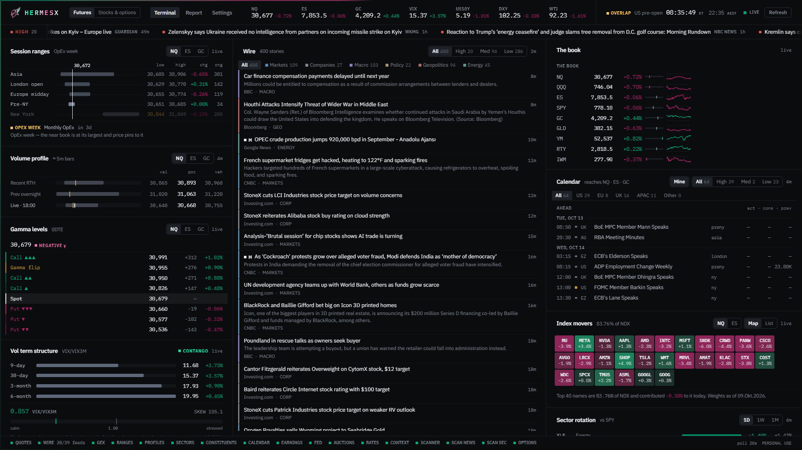

---

## Why this exists

I trade **NQ, ES and GC** futures across the **Asia, London and New York** sessions.
Going into any of them, the questions are always the same: what happened while I was
away, what is scheduled to happen while I'm trading, where are the levels that matter,
and what regime am I stepping into? Answering that meant a dozen tabs — news sites, an
economic calendar, a rates page, a charting platform, an options dashboard.

I also trade US stocks and ETFs through options in the New York session, on one
strategy: a break of the pre-market or previous-day high (low), entered on the
retest — or on VWAP / the 8 EMA when price runs too far. Those questions are
different: which names are strongest against the market, which levels they are
about to break, and what the options are pricing.

HermesX folds all of it into one screen, in the spirit of an institutional terminal:
**everything states its own age, its own source, and its own limitations.** Every
figure that changes flashes. Every panel answers exactly one question. And an LLM
writes a session note at the end — but only from facts the engine has already
computed, never from vibes.

It is named for Hermes: god of messages, information and speed, which is the whole
job description.

---

## The screen

Two desks behind one switch in the header — **Futures** (Terminal · Report) and
**Stocks & options** (Market · Scanner · Game plan) — with Settings on both. Each desk
remembers the tab you left it on; `1`–`4` move between a desk's tabs and `D` switches
desk. On the futures Terminal, three columns on one session clock:

| Column | Question it answers |
|---|---|
| **Left** | *Where are we?* — session ranges, volume profile, dealer gamma, the session clock, the vol curve, rates & the policy path |
| **Middle** | *What is happening?* — the wire: ~40 feeds, classified, deduplicated, impact-ranked |
| **Right** | *What is the market doing, and what's scheduled?* — the book, index movers, sector rotation, the economic calendar, Fed & Treasury diary, earnings, the macro board |

Above them: the desk's instrument strip (with the time in New York *and* in your own zone),
and a crawl of only the **high-impact** headlines. Below: a status rail listing
**every** data source — a dot for a healthy one, and anything down or serving a
**stale** cached copy expanded with its error and age (red, or amber for stale) —
because a terminal that hides a dead feed is lying to you.

---

## The futures desk

NQ, ES and GC across Asia, London and New York: the **Terminal** and the **Report**.

### The Wire
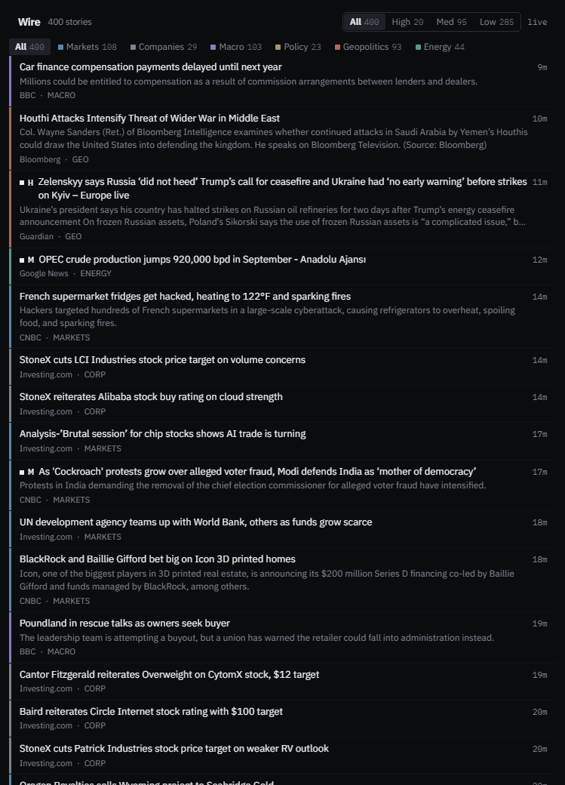

~40 RSS and query feeds (Reuters, AP, Bloomberg, WSJ, FT, CNBC, Nikkei Asia, SCMP,
Japan Times, the ECB, the Bank of England, the RBA and more), merged into one tape:

- **Desk classification** — every headline lands on a desk: `markets`, `companies`,
  `macro`, `policy`, `geopolitics`, `energy`. Title-only classification, because
  summaries lie about what a story is.
- **Impact tiers** — `HIGH` is a thing that *happened* (a rate decision, a strike, a
  print landing); speculation about the same event is demoted. Filterable.
- **A relevance gate** — world-feed items must earn a place on a market tape.
  Police-blotter stories are dropped on every desk (a "home invasion" is not an
  invasion), unless the story touches a market figure — violence against a CEO has
  repriced a sector before.
- **Cross-feed dedupe** that keeps the desk that filed first, encoding repair for
  double-encoded publishers, and section-page detection for query feeds.

### Session ranges, volume profile & dealer gamma
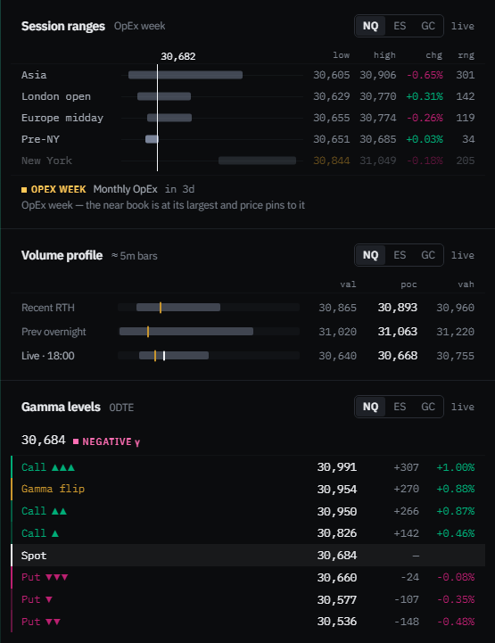

The left column's core: three panels, one price ladder each, `NQ / ES / GC` pickers on all.

- **Session ranges** — what Asia, London, Europe midday, pre-NY and New York each traded,
  from true 5-minute highs and lows, every bar on one shared price axis with the current price as a single line through all
  of them. A staircase is a trend, a stack is a range; a high or low printed in amber has
  been taken out — the handover read. Rows that are still yesterday's are dimmed.
- **Volume profile** — POC, VAH and VAL for three windows cut the way sessions are
  actually traded: the **previous RTH** (09:30–16:00 ET) as every session's reference,
  the **completed overnight** (18:00–09:30) once New York is trading, and a
  **developing profile** anchored at 18:00 ET through Asia/London and re-anchored at
  09:30 at the cash open. Each row draws its value area as a band, its POC as a tick,
  and live price as a marker. Built from 5-minute bars and labelled `≈` because that
  is what it is: zones, not ticks.
- **Gamma levels** — the seven prices where dealer hedging turns: three call walls,
  three put walls and the gamma flip for the **0DTE book**, with the regime badge
  (positive γ dampens moves; negative amplifies). Rank is drawn as chevrons —
  `▲▲▲` is the heaviest wall, not a footnote number. Sourced from a separate options
  analytics service over HTTP; if that service is down, this panel says so and shows
  nothing, because a stale gamma level is worse than none.

### The session clock & the vol curve
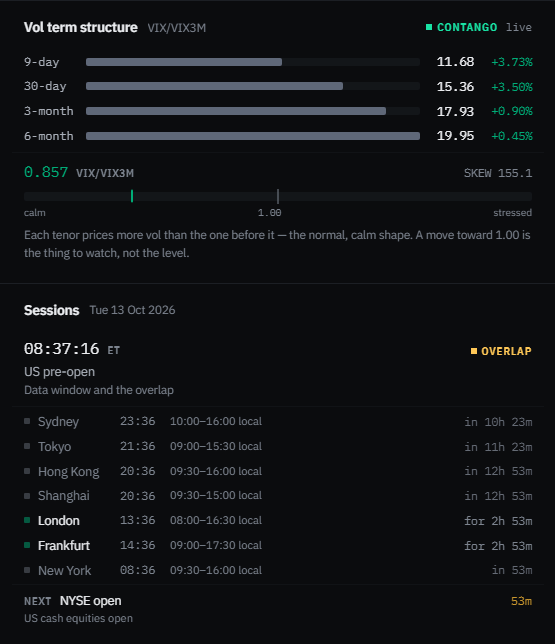

- **Sessions** — seven venues with local times and open/close countdowns, a phase
  headline (*"London session — Europe repricing the overnight"*) **derived from which
  desks are actually open**, not from a hardcoded table — so it can never contradict
  the rows beneath it, survives both hemispheres' DST changes, and the week is bounded
  by Globex (Sunday 18:00 ET is Monday morning, not the weekend). The NEXT marker
  counts down to real session moments — and shows an FOMC entry **only when the Fed's
  own calendar says there is one**. NYSE **holidays and half days** come from one
  table checked against the exchange's own calendar (Thanksgiving reads as a holiday,
  the day after closes at 13:00), countdowns skip weekends, and London's markers run
  on London's clock — so the weeks when the UK and the US change DST on different
  Sundays no longer put the London open an hour out.
- **Vol term structure** — VIX9D → VIX → VIX3M → VIX6M plus SKEW, with the
  VIX/VIX3M ratio drawn against 1.00: contango is the calm shape, backwardation the
  stressed one, and the crossover usually leads the index rather than following it.

### Rates, the policy path, and the FOMC meeting-by-meeting read
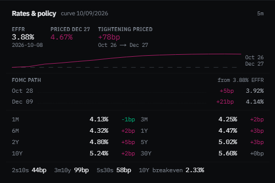

- The Treasury **curve** (1M→30Y) with daily basis-point changes, the classic spreads
  (2s10s, 3m10y, 5s30s) and the 10Y breakeven.
- The **fed funds futures strip** (15 months of ZQ contracts) rendered as the market's
  expected policy path.
- **FOMC path** — the strip un-mixed against the Fed's actual meeting dates into
  **basis points priced per meeting** (`Sep 16 +17bp → 3.79%`). Never "a 72% chance of
  a cut": probability framing needs an assumed move size, and this never assumes one.
  The one convention (day-count around mid-month decisions) is documented and tested.

### The book, index movers & sector rotation
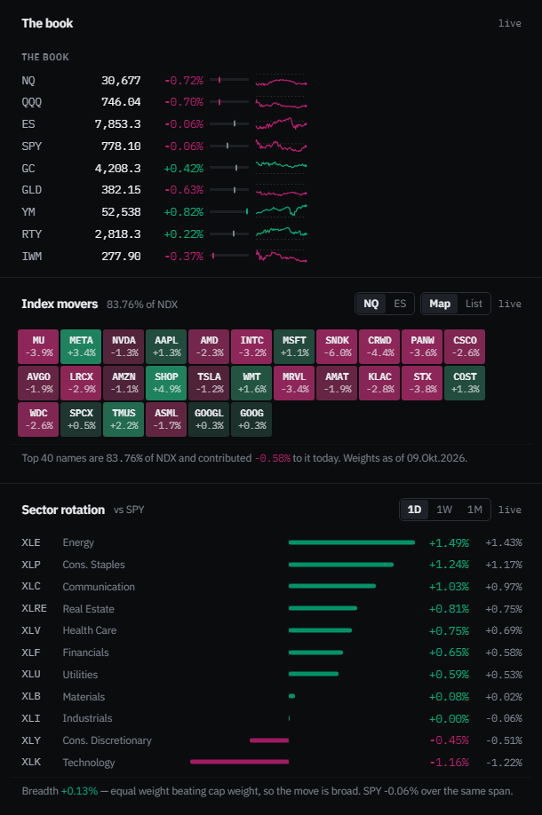

- **The book** — NQ/QQQ, ES/SPY, GC/GLD, YM, RTY with day-range position bars and
  sparklines.
- **Index movers** — the top ~40 NDX/SPX names by **contribution** (weight × return),
  as a heat-map or ranked list, with the honest footer: how much of the index the
  shown names are, and what they added to it today. "NQ is down" and "NQ is down
  because two names are" are different facts.
- **Sector rotation** — the eleven S&P sector ETFs as **excess return vs SPY** (the
  only view that says anything on a day when everything is red), plus the breadth
  line: equal-weight against cap-weight, i.e. is this move the market or just its top.

### Calendar, Fed & Treasury diary, earnings
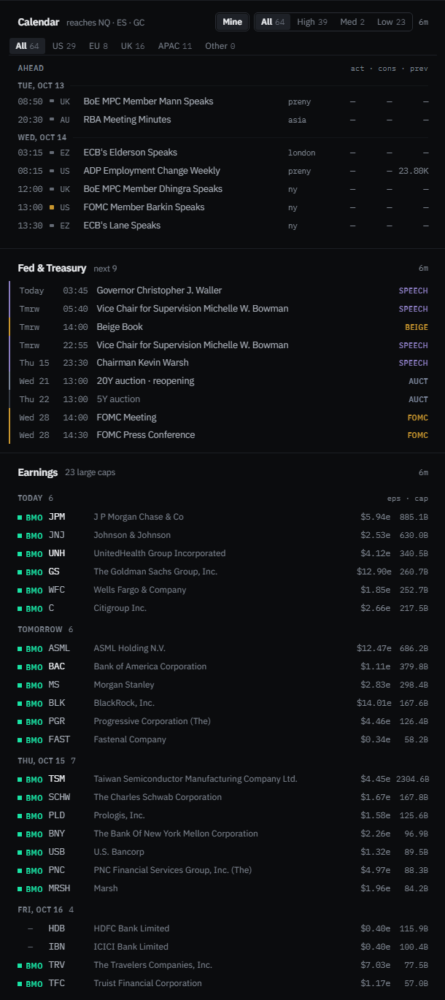

- **Economic calendar** — impact-scored, region-filterable (US/EU/UK/APAC), each event
  tagged with the trading session it lands in, and a `MINE` filter that narrows to
  releases that actually reach NQ, ES or GC. Three figures per row — `act · cons ·
  prev` — because markets move on the gap between actual and consensus, not on the
  number itself.
- **Fed & Treasury** — one diary of scheduled US rates risk: FOMC meetings, the Beige
  Book, governor speeches and testimony from the Board's own calendar, merged
  chronologically with **coupon auction supply** (3Y/10Y/30Y, reopenings named what
  the market calls them) from TreasuryDirect — because a tailed 30Y at 13:01 ET is an
  equity event for the longest-duration index on the board.
- **Earnings** — the coming week's large caps ($50bn+ and bellwethers), BMO/AMC
  tagged, estimates marked with an `e`, and actuals shown against the estimate and
  coloured by the surprise once they print.

### The AI session read
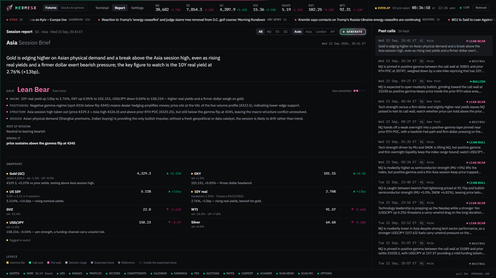

The Report tab generates a **pre-session brief** on demand: pick the session (Asia /
London / New York / auto-by-clock) and the book (NQ / ES / GC / all three). The
collector computes every table on the page from the live snapshot, then an LLM (via
OpenRouter, with a model-and-mode fallback chain) writes the read around them. Top to
bottom:

- **Partial data** — which sources were down when it was written, so a missing level
  is a stated gap rather than a silent one.
- **Thesis and calls** — the one idea of the day, then a card per book: the call at
  the open with its conviction, the rest-of-day lean, and the price that makes it
  wrong.
- **Snapshot** — the books, the dollar, the 10Y (and the real yield for gold), vol,
  oil and the yen, with week and month context; the model flags the rows to watch.
- **Levels** — a ladder per book in price order: gamma flip and walls, the
  expected-move band (GEXYGEN's own, or a one-day 1σ from VXN / VIX / GVZ when it is
  down), the overnight or handover range, prior-RTH high / low / POC and settle, each
  measured from last.
- **Dealer gamma** — regime, the flip's distance in percent and in expected moves,
  the walls.
- **Catalysts** — data, the Fed (with what each FOMC has priced), long-end auctions
  and bellwether earnings, from twelve hours back to three days out; the model notes
  the ones that matter.
- **The read** — per book: the regime, the macro transmission as a chain of causes,
  the open, the invalidation, the rest of day, what flips it, and drivers tagged
  bear / bull / mixed / neutral.
- **Rotation** — six equity ratios (or GDX/GLD and gold/silver) with five-day
  direction, the megacaps' moves, and the model's read of the tape.
- **Headlines that move price** — picked from the wire by id and tagged with the books
  they move.
- **Past calls** — every prior brief kept with its full digest and tables attached, so
  any call can be audited against exactly the data it saw.

The design principle throughout: **the engine computes, the model narrates.**

- The tables are never the model's. The page prints them from computed facts, and the
  model's notes join onto rows by id — a note pointing at an id that does not exist is
  dropped before it is stored.

- The digest is scoped to the chosen book — the instrument's own data is one block,
  everything else is explicitly `context_only`, because structure is obeyed where
  instructions are merely read.
- Headlines are re-weighted to the session's home region; the calendar block tags
  which events land inside the session being written.
- The volume-profile block states the market-profile reads **as computed facts**:
  each window's shape (P / b / D / double distribution), where the session *opened*
  relative to prior value, and where price trades *now* — above value, inside, or
  below. The model is told to cite the classifier's decisions, not to re-derive them.
- Every claim in the note must quote a figure from the digest; a hedged guess
  presented confidently is treated as worse than no note — and that is **checked**,
  not hoped for: every number in the model's prose is matched against the digest,
  the model is asked once more if any are missing, and any that survive are listed
  in an **Unverified figures** banner above the note.
- A source serving a stale cached copy when the note is written is named in the
  **Partial data** banner with the copy's age, so a brief is never written on frozen
  prices without saying so.

Reports persist to disk with their full digest attached, so any note can be audited
against exactly the data it saw.

## The stocks & options desk

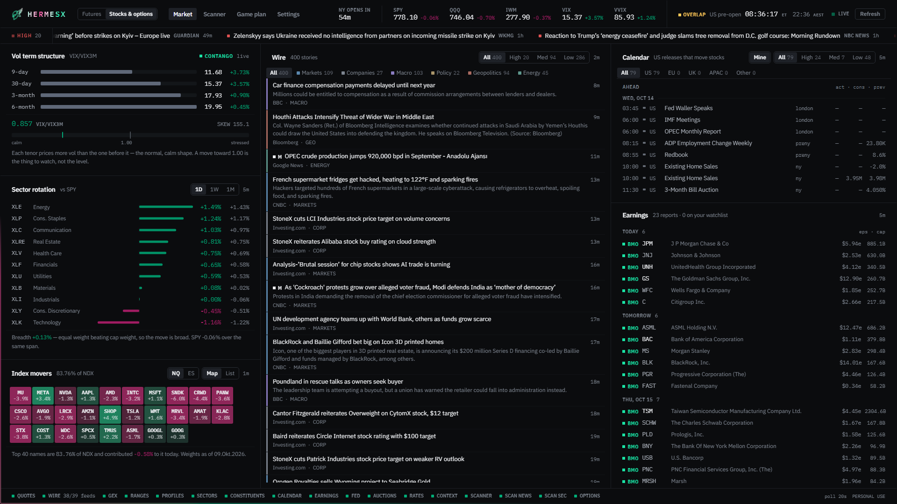

The second desk is for the US stocks and ETFs I trade **through options** in the New
York session — a different instrument, a different clock and a different risk unit
from the futures, so it gets its own header strip (SPY, QQQ, IWM, VIX, VVIX, the 10Y
and a countdown to the New York open or close) and its own tabs: **Market**,
**Scanner** and **Game plan**. The wire, the calendar, the vol curve and rotation are
shared — macro moves both books — but arranged here for an equity trader:

- **Market** — the vol curve, sector rotation and index movers; the wire; and a
  calendar whose `MINE` filter means *US releases that move stocks* (the futures
  desk keeps its NQ · ES · GC reading), earnings with the watchlist's names marked,
  and rates.

### The Scanner — break and retest, ranked
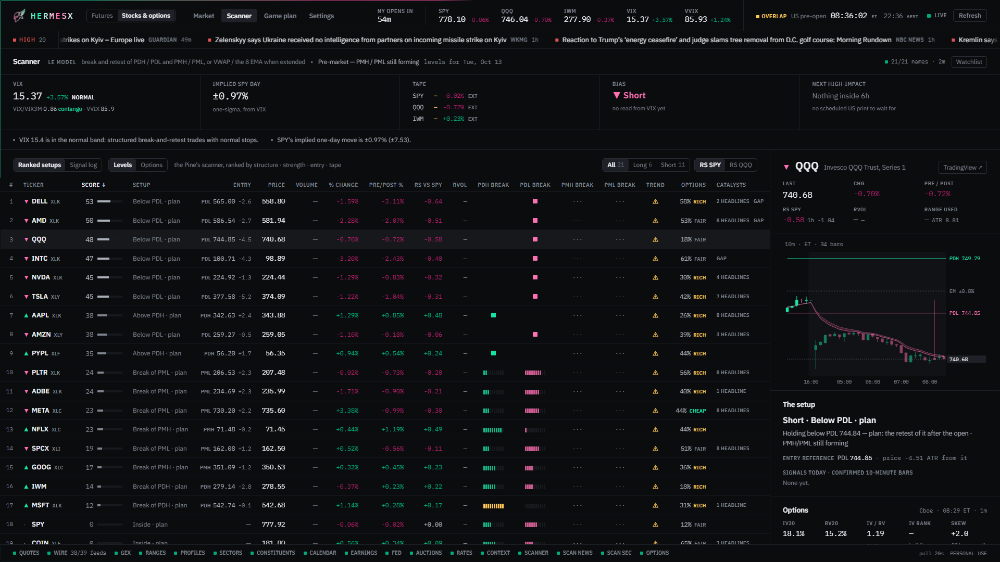

The **Scanner** tab is the `LE_Model.pine` scanner, computed by the engine instead
of drawn by TradingView, for the New York strategy it was written for: a name
breaks its **pre-market** or **previous-day** high (low), and the trade is the
**retest** of that level — or of **VWAP / the 8 EMA wave** when price has run too
far from the level for it to come back.

- **Every column the Pine's scanner has** — Price, Volume, % Change, Pre/Post %,
  RS vs SPY, PDH / PDL / PMH / PML Break (the script's ten-segment bars, a filled
  square once broken, dots while the pre-market range forms, amber at 90% where its
  "about to break" alert fires) and Trend (▲ ▼ ⚠) — under the script's own names,
  with the engine's score, setup and entry in front of them. An **Options** column
  set swaps them for the options read below; the ticker column stays pinned while
  the rest scroll sideways on a narrow screen.
- **The Pine, ported faithfully** — PDH / PDL from the previous regular session,
  PMH / PML from 04:00–09:29, break progress toward each level (a bar, or a filled
  square once broken), the Pine's trend and wave state, the 8/9/10 EMA wave on
  ten-minute bars, and **relative strength vs SPY and QQQ** with each move scaled by
  that name's own daily ATR. The `(L)` level-retest and `(E)` 8-EMA signals are
  replayed on confirmed ten-minute bars, in the script's own order of operations.
- **The setup, in words** — retest live, pulling back, extended (so the entry
  reference becomes VWAP or the 8 EMA), near a break, failed, or inside and
  chopping — with the entry price and price's distance from it in ten-minute ATRs.
- **The weather strip** — VIX, its curve (VIX/VIX3M) and VVIX, the one-day implied
  SPY move (VIX ÷ √252), SPY / QQQ / IWM against their *own* levels, the tape's
  bias (confirmed or contradicted by which way VIX is moving), and the next
  high-impact US print. **VIX never ranks a name by itself**: it is the weather,
  and it reaches a score only through the market part.
- **A ranked list, not a black box** — every score is a sum of named parts
  (structure 30 · relative strength 25 · entry location 20 · relative volume 10 ·
  market 15, less penalties for a spent daily range, a print inside 30 minutes, an
  after-the-close report today, or a failed break), each listed with the points it
  earned. It orders the list; it is a **heuristic rank, not a measured
  probability**, and the page never calls it one.
- **What the chart does not show** — each name's headlines (Yahoo's per-ticker
  feed, tagged rating / earnings / filing), its next or latest earnings with BMO /
  AMC and the surprise, and its SEC filings from the last three days (8-K items,
  offerings, 10-Q / 10-K) straight from EDGAR.
- **A chart for the selected name** — ten-minute candles with PDH / PDL (solid) and
  PMH / PML (dashed) as the Pine draws them, the 8 EMA wave tinted by the level
  state, VWAP, the signals where they fired, and extended hours shaded — plus a
  one-click **open in TradingView**.

  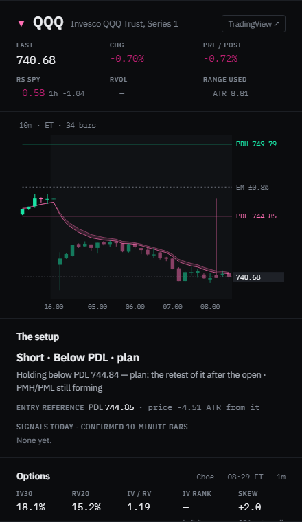
- **Alerts on every tab** — the Pine's alerts, raised by the terminal: a toast, a
  chime (rising for a long, falling for a short) and, once allowed, a desktop
  notification when a name fires an `(L)`, an `(E)`, a ◆ breakout, or gets 90% of
  the way to a level. Only live events alert — a reload or a collector restart never
  replays the morning. What fires, the minimum score and the sound are in
  Settings → Alerts.
- **The signal log** — every signal the engine saw, kept for 30 days with what it
  did afterwards **in R**, where R is the Pine's own stop idea: the best and worst
  excursion, whether +1R came before the stop, and where it stood 30 and 60 minutes
  on and at the close — and a record by group (kind, side, score band). A bar that
  touches both the stop and +1R counts as stopped. It is a record, not a forecast,
  and it says so while the sample is small; it is what the score's weights get
  calibrated against.
- **An editable watchlist** — the Pine's 21 names by default, up to 40, kept by the
  collector; SPY, QQQ and IWM are always fetched as the benchmarks. A symbol Yahoo
  does not know backs off instead of being retried every tick.
- **Keyboard** — the rows are in the tab order, Enter picks one, ↑ / ↓ walk the list.

Relative volume starts at the open: Yahoo's pre-market bars carry no volume, and
the column says so rather than guessing.

### Options — Cboe's chains, read the way a trade is decided
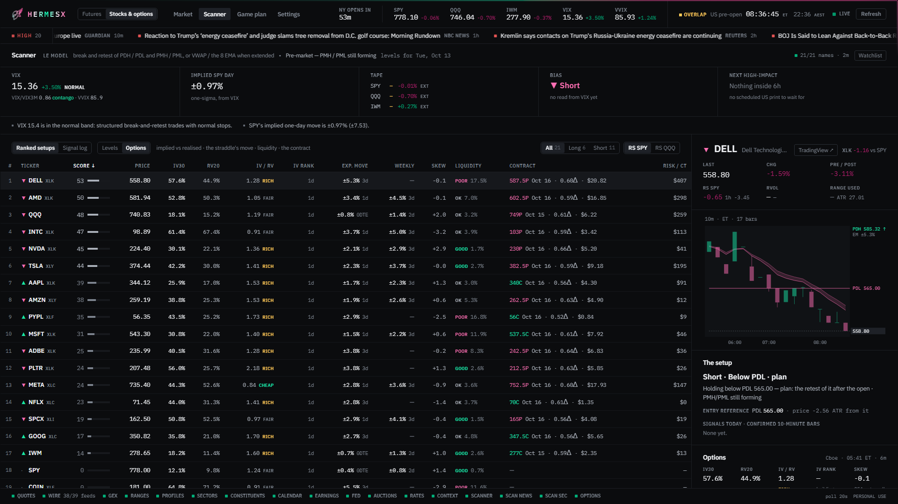

Every scanner name carries its options context, from **Cboe's free delayed chains**
(about fifteen minutes behind, read directly — the index ETFs every five minutes,
single names every ten, one request every ten seconds at most):

- **Is premium cheap or rich?** IV30 against 20-day realised volatility — under
  0.90 cheap, over 1.25 rich — and an **IV rank** that builds from a daily log
  (it says how many of the twenty sessions it needs it has).
- **How far does the market expect it to go?** The front expiry's at-the-money
  straddle as a dollar and percentage band — **0DTE on SPY, QQQ and IWM** when
  one is listed — and the weekly's, drawn on the chart as a dotted band.
- **Can it be traded, and should it be held?** The at-the-money spread and open
  interest graded good / ok / poor, the 25-delta skew, and a warning when earnings
  land before the expiry (implied volatility collapses after the report).
- **The contract.** For the setup's side: a long option at the strike nearest
  0.60 delta, and a debit spread selling the 0.30 delta, each with its premium,
  delta, theta and spread — and **the premium at risk to the setup's own stop**
  (stop distance × delta × 100, an approximation it names). Set a risk per trade
  in Settings → Options and it also says how many contracts that buys. Rules, not
  advice.

### The Game plan — the stocks desk's own brief
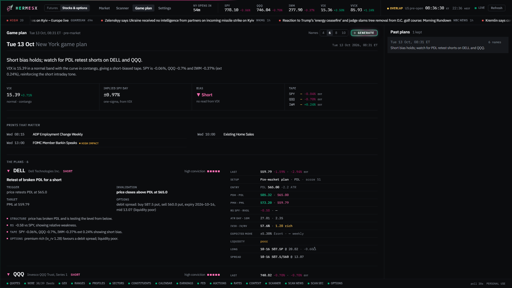

A pre-open plan for the New York session, written by the same model chain as the
futures brief but from the **scanner's** facts: the top four to ten names by score,
SPY and QQQ for the tape, the regime, the day's US prints, each name's headlines and
its options context.

- **Per name:** the side and a conviction, the plan in one sentence, the trigger,
  the invalidation, the first target, **how to express it in options** (long or
  spread from implied vs realised, which expiry, earnings inside it) and why —
  each reason naming its layer.
- **The facts beside the prose are the server's**, printed from the scanner, never
  from the model; a plan for a name that is not in the facts is dropped, and every
  number in the prose is checked against the data (the same guard as the futures
  brief).
- Also: the names to leave alone, the clock (prints, the open, lunch, the close),
  and the risks. Past plans are kept to judge against the day.

## The chassis

**Quiet Terminal is the default interface** — GEXYGEN's flat chassis, carried
across by copying (never by linkage): one neutral grey ramp, hairlines instead of
cards, sentence-case section titles, condensed caps labels, square markers, IBM
Plex Sans / Condensed / Mono, and a header that carries the instrument strip as
label-over-figure in one band. The data hues are the only colour on the screen.
**Classic** — the carded, neon, mono-caps chassis this terminal shipped with — is
one click away in Settings → Interface; everything Quiet changes is scoped under
`.ui-qt`, so Classic is simply the absence of the class.

Either way: three-hue discipline (a colour on a figure means calls, puts, or the
flip — decoration lives on its own tokens), an animated frame light (a
compositor-only rotation — it costs the page nothing measurable), a wordmark
and helm that wash on one shared cycle, and a change-flash on every figure that
ticks. Themes are configurable, per-panel filters persist in `localStorage`, and
the whole board is keyboard-free by design — it is meant to be *read*.

---

## What it gathers

| Source | What | Cadence |
|---|---|---|
| Yahoo Finance (spark) | 50+ instrument quotes: futures, ETFs, FX, rates, vol complex, global indices, crypto | 20s |
| Yahoo Finance (chart) | 5-minute OHLCV bars for NQ/ES/GC → session ranges & volume profiles | 1–5 min |
| Publisher RSS + query feeds | ~40 feeds across six desks, region-tagged | 2 min |
| Nasdaq | Economic calendar (consensus/actual/previous) and the earnings calendar | 10 min |
| U.S. Treasury (yields) & fed funds futures | The curve, spreads, and the ZQ strip | 30 min |
| Federal Reserve (`calendar.json`) | FOMC dates, speeches, testimony, Beige Book | 1 h |
| TreasuryDirect | Upcoming coupon auctions | 6 h |
| iShares holdings CSVs | NDX/SPX constituent weights → contribution math | daily |
| Yahoo Finance (chart, per stock) | 5-minute bars 04:00–20:00 for every watchlist name → the Scanner's levels, wave, VWAP and signals; daily bars for the ATR | ~90 s a name in session (SPY/QQQ/IWM 30 s), 15 min closed; daily 6 h |
| Yahoo Finance (per-ticker RSS) | Each watchlist name's headlines | 10 min a name |
| Cboe (delayed option chains) | Each watchlist name's chain → IV, the straddle's expected move, skew, liquidity, the suggested contracts; a daily IV log for IV rank | 5 min SPY/QQQ/IWM, 10 min singles, in session; hourly otherwise |
| SEC EDGAR | Each watchlist name's filings from the last three days | 30 min a name |
| A companion options-analytics service | The seven dealer-gamma levels per book, over HTTP | 30 s |
| OpenRouter | The futures session note and the stocks game plan (configurable model, fallback chain) | on demand |

Everything flows through one **warm-snapshot collector**: a single background thread
polls each source on its own cadence into memory; the API serves reads from that
snapshot and never blocks on a fetch. Slow sources can be stale — and say so — but
the terminal itself is always instant.

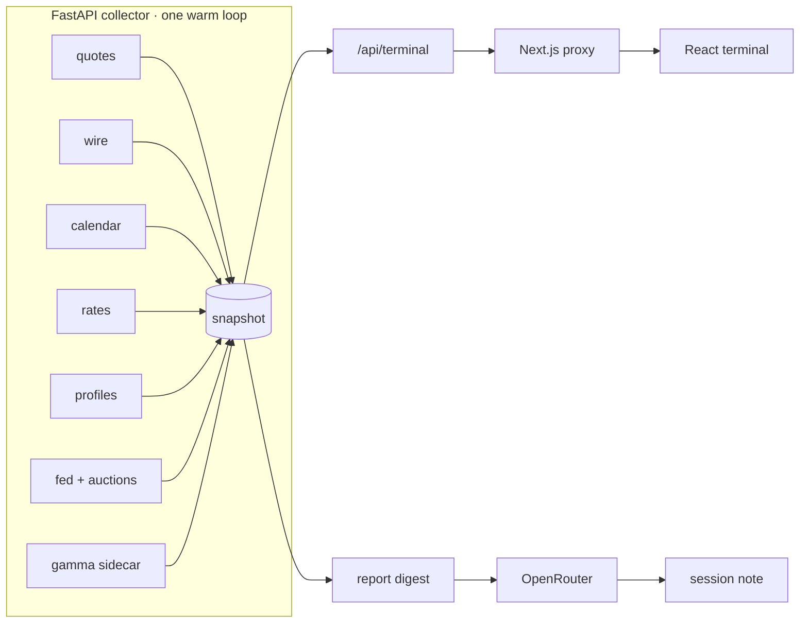

---

## Running it

Windows, Node 20+, Python 3.11+.

```powershell
npm install
cp .env.example .env.local     # add an OpenRouter key if you want session reports
.\dev.ps1                      # every half in its own window, then the browser
npm run shortcut               # optional: the same thing, on the desktop
```

- Web: **http://localhost:3100** · Collector: **http://127.0.0.1:8100**
- `.\server\run.ps1` starts the collector alone — its window *is* the feed log: one
  row per source per refresh, with ages and item counts. Always start it through the
  script; it is what loads `.env.local`.
- The gamma panel reads a companion options service on `:8000`; without it, that one
  panel reports itself unavailable and everything else runs normally. `dev.ps1` will
  start that service too if it finds it beside this repo (or at `NT_GEXYGEN_HOME`) —
  a launch-time convenience only, skipped with `-NoGexygen`, and silent about every
  way it can be absent.
- Switches: `-CollectorOnly` (feeds, no web, no browser), `-NoBrowser`, `-Force`
  (start anyway, and clash), `-Prod` (the web half as a production build in
  `.next-prod` rather than `next dev` — lighter for a screen left open all day;
  `npm run prod` does the same by hand). Everything already listening is left alone, so a second
  run restarts nothing and is simply how you get the browser tab back.
- `npm run shortcut` puts a **HERMESX** launcher on the desktop, winged helm and all,
  pointed at `dev.ps1`; `npm run shortcut:collector` adds a feed-only one beside it.
  The icon is `public/hermesx.ico`, rendered from the same traced path as the header
  by `npm run icon` — re-run that only if the mark or its hues change.

Checks: `npm run check` runs TypeScript, ESLint, Ruff, mypy (strict) and the pytest
suite — 316 tests, most of them regression tests bought with a real observed bug:
the classifier rules, the FOMC un-mixing, the profile session windows, the
scanner's Pine port and its clock boundaries, the JSON
extractor's four observed wrappings.

---

## Honest limitations

- **Personal-use data.** The quote and news sources here are free feeds that are fine
  to read at one desk and are **not redistributable**. This repository is published as
  code; if you deploy it for anyone but yourself, replace `server/newsterminal/sources/quotes.py`
  and `wire.py` with licensed sources first. That constraint shaped the design and is
  a feature of it, not an oversight.
- **Volume profiles are approximate** — built from 5-minute bars, labelled `≈` in the
  UI, and intended as context. Execution-grade profiles belong to tick data.
- **Yahoo's extended hours are partial.** Pre-market bars carry no volume (so relative
  volume starts at the open), and earlier days come back without their post-market
  beyond the 16:00 print — so the scanner's EMA wave skips the previous evening that
  TradingView, with extended hours on, would include. The four levels are unaffected.
- **The scanner's score is a heuristic rank**, not a probability — until the signal
  log has enough settled sessions to calibrate it.
- **Free-tier LLMs are flaky.** The report chain retries across models and modes,
  parses JSON out of four kinds of wrapper, and fails loudly with the full attempt
  trail when the pools are saturated.
- **Desktop-width layout** (≥1280px). It is a terminal; it assumes a monitor.

---

## The mark

The winged helm is my own line art. In the app it lives as a single traced vector
path (`src/lib/hermesMark.ts`), recoloured live to the terminal's chrome hues. The
icon reads that same file rather than copying it, and adds only what a wallpaper
does not supply: a chassis-black tile under the lockup's green-to-pink wash. The
browser tab and the desktop shortcut share that one `.ico`, so the launcher, the tab
it opens and the page inside it are one identity.
