<div align="center">
  
  <h1>Hermes</h1>

  <p><strong>Financial Markets &amp; Macro News Terminal</strong> with two desks.
  One for <strong>US stocks and ETFs traded through options</strong>: the
  break-and-retest scanner, Cboe's option chains read for the trade, a tape count
  that caps conviction, a pre-open game plan written from the scanner's own facts,
  and Hermes to explain any figure on the screen. One for trading Nasdaq,
  S&amp;P 500 and Gold futures across the Asia, London and New York sessions — a
  live news wire, the driver board, dealer options positioning and gamma levels, the
  economic calendar, earnings, and a Fed &amp; Treasury diary — with
  <strong>AI-powered session reads</strong> built from facts the engine computed.
  Across both, <strong>Hermes AI</strong> reads the whole terminal through tools and
  answers in a chat of its own, every figure it quotes checked against the data.</p>

  <p>
    
    
    
    
    
    
    
  </p>
</div>

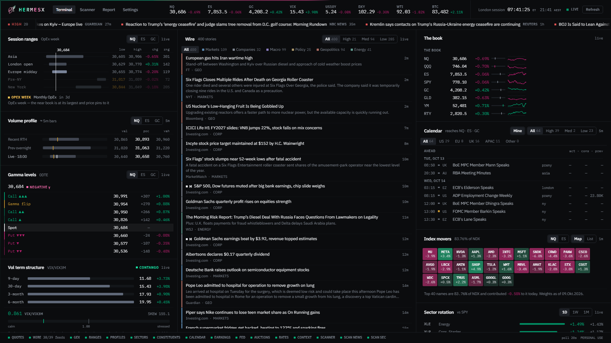

---

## The stocks & options desk

The desk for the US stocks and ETFs I trade **through options** in the New York
session — a different instrument, a different clock and a different risk unit from
the futures — so it has panels of its own: the Scanner, the game plan, the tape
count. The wire, the calendar, the vol curve and rotation are shared, because macro
moves both books. Since 2026-10-30 both desks share **one tab bar** and one header
strip, cut by what a page is for rather than which book it is about: **Dashboard** (the
session on one page), **Macro** (what is happening and what is scheduled), **Futures**
(everything about NQ, ES, GC, silver and crude: an overview of the five and a view per
contract with its chart, levels, session ranges, volume profile and gamma), **Scanner**
(with the written game plan as its last view; an **Index** view of SPY, QQQ and IWM's
own structure sat beside it until 2026-11-13), **Sectors**, **Hermes AI** and **Settings**. Each desk's written note
lives in its own section: the futures brief is **Futures → Brief**, the stocks game
plan **Scanner → Game plan** (an Analysis tab held both behind a switch until
2026-11-11; its links still land on the right one).

Every part of it is built the same way, and this section walks them in order: the
engine computes a figure, the figure opens a read of what it means for this trade,
and only at the end does a model write anything — the Scanner's written game plan, and
Hermes when asked (its own section, after the futures desk).

### The Dashboard — the session on one page


The first tab answers "what is my plan before the open" without adding anything to what
the other tabs already hold, and every part opens where it came from. Three rows:

- **The read and the game plan.** Two sentences written by a fixed rule from the tape
  count, the VIX band and breadth; who reports and the next print. Beside them the tape's
  bias, the sectors and themes ahead of SPY, the count of Day 2/3 continuations and of
  breakouts and breakdowns through the previous day's range, and every stock at $2bn+ by
  the size of its move.
- **Top setups, what's in play, the news.** The top setups are the Scanner's own rank, because
  nobody here picks names by hand, each with its side, where it sits against the previous
  day and the pre-market, the setup, its most important story and today's chart. Beside
  them **In play**: the pool's rank across every stock it screens, each with why (the gap
  in its own ATRs, pre-market volume against an average day, a report, a story, a level
  already taken, a Day 2 or 3) and what the engine has done about it — taken at a mark,
  pinned, on the list, or one Track away — with the pool's counts and its next mark in the
  header; and the freshest major company stories, one line per event.
- **Sector rotation.** The eleven sectors on one row with the stocks pushing each; a card
  opens that sector on the heat map.

### Index — is the tape with me?
This was the Scanner's **Index** view (Structure's stocks half until 2026-11-10). The
view was removed on 2026-11-13, when the app was cut down to what a session is traded
off: SPY, QQQ, IWM and VIX are in the band over every Stocks view, the tape's count is
the **Tape** figure on the Setups row (the votes are its hover), and breadth is the
Dashboard's card. The picture is the view as it was. The collector still computes
everything below and Hermes reads all of it.

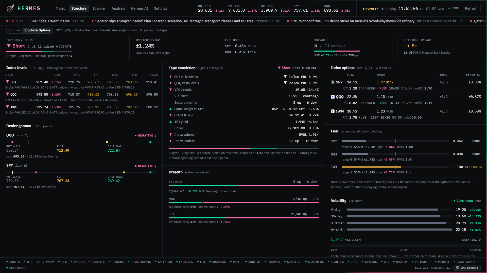

- **Tape conviction** — eleven reads of the tape (SPY and QQQ against their own
  levels, which way VIX is moving and its curve, sectors moving, equal weight against
  SPY, credit, the 10Y, the dollar, index volume, index leaders), each a vote with its
  threshold stated. They are weighed by family into a score from -100 to +100 (the
  driver board's rule, below), graded weak / moderate / strong, and the grade **caps
  the game plan's convictions**: a weak tape caps a plan at 3 of 5.
- **Breadth** — sectors up against down, equal weight against the cap-weighted
  index, and how many of the NDX and SPX names are up with what the top three carry.
- **Fuel** — how much of the implied day SPY and QQQ have already used, from the gap
  and the pre-market, so a break into a spent range reads as one.
- **Prints & the Fed** — the session's US releases against consensus, and the FOMC
  path meeting by meeting. **Cross-asset** — the 2Y, the 10Y, 2s10s, credit, the
  dollar, long bonds, oil, gold and bitcoin: what stocks lean on today.
- **The wire and the calendar** are the Macro tab's, shared with the futures desk;
  the calendar's `MINE` filter narrows to the US releases that move the books.

### The Scanner — break and retest, ranked
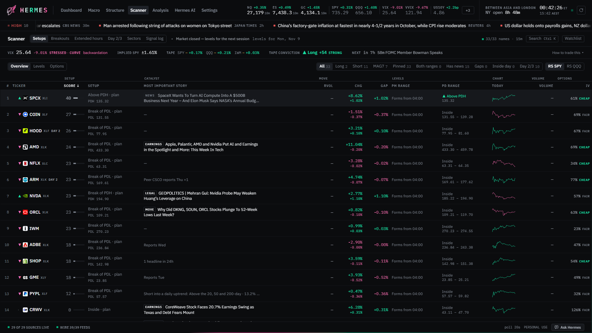

The **Scanner** tab is a TradingView Pine scanner, computed by the engine instead
of drawn by TradingView, for the New York strategy it was written for: a name
breaks its **pre-market** or **previous-day** high (low), and the trade is the
**retest** of that level — or of **VWAP / the 8 EMA wave** when price has run too
far from the level for it to come back.

The tab has six views in a strip: **Setups**, the ranked list this section describes;
**Breakouts**, **Extended hours** and **Day 2/3**, the wide scan read three ways; **Index**,
the tape; and the **Signal log**. (**Sectors**, the wide scan's fourth reading, is a tab of
its own since 2026-11-10 — below.) Setups opens on **Overview**, the short list of what matters (the
name with its tags, the most important story, relative strength against SPY, the move, the two
ranges in words, the day's line, the volume, then the setup and the score); **Levels** has every
column of the Pine's
scanner, and **Options** the options read, both under **Columns**. Implied against realised
volatility is on Options alone since 2026-11-11: as a column on the other two it read the
market's last month and each name's report date, not the name (30 of 40 rows said "cheap" that
morning, SPY, QQQ and IWM among them). A row of figures heads
the page: the names on each side, the top relative volume and mover, the tape and the next
print. Before the bell two columns say what they hold instead of going blank or reading as
today's: relative volume has no time-of-day figure yet, so its column (and the Top card) shows
the pre-market's volume as a share of an average day, the figure the pre-open rank reads; and
Chg is headed *last session*, with the pre-market or after-hours move labelled under it.

- **Every column the Pine's scanner has** — Price, Volume, % Change, Pre/Post %,
  RS vs SPY, PDH / PDL / PMH / PML Break (the script's ten-segment bars, a filled
  square once broken, dots while the pre-market range forms, amber at 90% where its
  "about to break" alert fires) and Trend (▲ ▼ ⚠) — under the script's own names,
  with the engine's score, setup and entry in front of them, and a **200** column
  for which side of the ten-minute 200 EMA the name trades on: longs above it,
  shorts below, and a retest into it tends to fail. An **Options** column
  set swaps them for the options read below; the ticker column stays pinned while
  the rest scroll sideways on a narrow screen.
- **The Pine, ported faithfully** — PDH / PDL from the previous regular session,
  PMH / PML from 04:00–09:29, break progress toward each level (a bar, or a filled
  square once broken), the Pine's trend and wave state, the 8/9/10 EMA wave on
  ten-minute bars, and **relative strength vs SPY and QQQ** with each move scaled by
  that name's own daily ATR. The `(L)` level-retest and `(E)` 8-EMA signals are
  replayed on confirmed ten-minute bars, in the script's own order of operations.
  **One departure, on purpose** (quant audit, 2026-11-13): the ten-minute ATR behind
  the retest buffer, the extension test and the stop floor counts regular-session bars
  only, a session's first bar as its own range. Over every bar, as the script's chart
  ATR is with extended hours shown, fourteen thin pre-market bars set the 09:30 buffer
  (a third of the session's own on a quiet morning) after the 04:00 bar's overnight gap
  had swelled it, so the opening bars read extended and a near-miss retest missed.
- **The levels are the official day's** — PDH, PDL and the open come from the daily
  bar wherever it reaches further than the 5-minute bars, which leave out the opening
  cross and the first prints after the bell. Measured on 440 name-sessions (forty
  names, 26 Oct to 9 Nov 2026): the bars' high sat under the day's by more than 5c on
  23 and their low over it on 31, never the other way, and the first bar's open was
  more than 0.10% from the official open on 96. AVGO's high on 6 Nov was 311.52
  where the bars said 306.20; MU's gap on 10 Nov read -3.05% and was -2.15%. Yahoo's
  daily bar matched TradingView's to the cent on every name checked, and after the
  change PDH and PDL agree with TradingView's daily bar on 37 of 37. The daily bars
  are read again from Yahoo just after the open (09:33 and 10:05 ET) and after the
  close, a copy made before a session's close is never trusted for its range, and
  where the official level sits past the bars the Levels card says so, since the
  candles stop short of the line.
- **The setup, in words** — retest live; through its level with the retest as the entry
  (*Above PDH · entry is the retest*: it read "Pulling back to PDH" until 2026-11-11, and
  nothing measures which way price is travelling); extended (so the entry reference
  becomes VWAP or the 8 EMA); near a break; failed; or inside and chopping — with the
  entry price and how far it sits from price in ten-minute ATRs (*PDH 515.18 · 2.0 ATR
  below*).
- **The daily frame** — a year of daily bars per name: above or below the 20, 50
  and 200-day, the distance from the 52-week high, last week's range. A sixth score
  part (with the daily trend, between the averages, or against it), and a flag when
  a setup runs against it: a PDH break inside a downtrend is not the same trade as
  one at new highs.
- **Short interest** — the share of the float sold short and the days to cover,
  from FINRA via Yahoo; a short on a name past 15% carries a squeeze flag, a long
  the fuel.
- **The weather strip** — VIX, its curve (VIX/VIX3M) and VVIX, the one-day implied
  SPY move (VIX ÷ √252), SPY / QQQ / IWM against their *own* levels, the tape's
  bias (confirmed or contradicted by which way VIX is moving), and the next
  high-impact US print. **VIX never ranks a name by itself**: it is the weather,
  and it reaches a score only through the market part. The four bands (13 / 20 /
  28) score; two sub-lines inside them only change the words: **18**, the VIX's
  long-run median, below which the tape tends to mean-revert inside the day
  (dealers long gamma: the retest holds, fades work) and above which it tends to trend
  (dealers short gamma: breaks run, stops a notch wider, 1%-plus days normal),
  with the chip reading `Normal · 18+`; and **35**, panic, where the VIX's own
  mean reversion is the trade. The level is a proxy for the gamma flip, which
  the driver board reads directly, and the table says so. Every row of the table
  has two columns, *what the tape does* and *how to trade it*, the second written
  for the desk's own break-and-retest: does the retest hold, how wide the stop,
  what size. Every VIX figure's click-through also
  reads the level against its own month: the percentile of the last twenty closes,
  because an 18 after a week at 13 is not an 18 after a week at 25.

  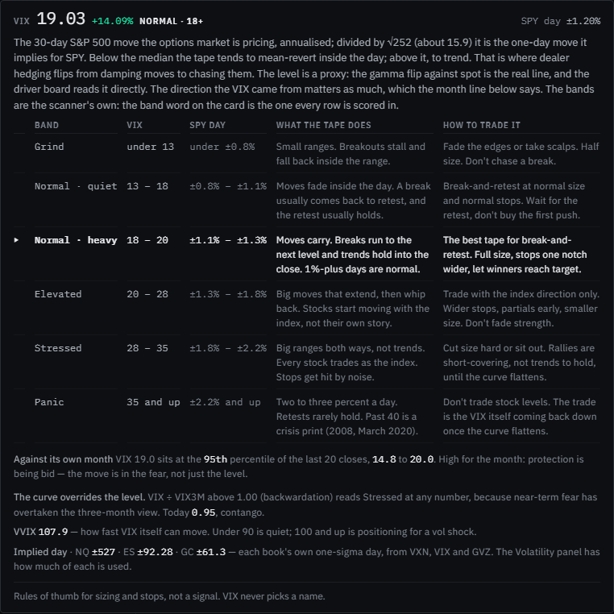
- **A ranked list, not a black box** — every score is a sum of named parts
  (entry location 25 · structure 20 · relative strength 20, in full only on a live
  entry — a retest, a pullback, near VWAP or the 8 EMA — and at most 5 anywhere else ·
  market 20 · relative volume 8, or before the bell (and until the first RVOL after
  it) the gap and the pre-market volume · the daily frame 6 · the catalyst 20, less
  penalties for a spent daily range, a print inside 30 minutes, an after-the-close
  report today, a failed break, a signal still live from the first thirty minutes or
  the last hour, options too wide to trade, or a catalyst against the side), each
  listed with the points it earned. The score shows capped at 100; **the list is
  ranked on the uncapped sum**, so a penalty counts at the top, and in the regular
  session **a name under 1.0× RVOL is kept out of the top ten** (the row says so).
  **RVOL is one figure on every page** (2026-11-13; there were six): in the session the
  volume so far against an average day to the same minute, after it the whole day
  against an average day, and before the bell the pre-market against the name's usual
  pre-market (the Extended hours figure). A name on this list shows this list's own
  RVOL on Breakouts, Day 2/3 and Sectors too, and the pool's volume part reads RVOL,
  full at 2×, where it read a share of a whole average day and so grew all afternoon.
  The Volume column's **share of an average day** counts today's shares as the tape
  does: the 5-minute bars miss a fifth or more of them (META, 12 Nov: 8.09M against
  10.25M), so a normal day read about 75%. RVOL still divides the bars by the bars.
  These weights date from the quant audit of 2026-11-13: on sixteen sessions of logged
  signals, entry location and market alignment carried the edge, strong RS failed only
  where the entry was extended, and RVOL said how far a name would still move but not
  which way. In-sample, so a better starting point rather than a measured one.
  The **catalyst** reads direction, never a count, and pays by what the news is: a
  report's surprise, guidance, an FDA readout, a deal, an offering, an index change, a
  short seller's report or the name's own move with its reason earn the full twenty;
  an upgrade or downgrade, a buyback, a split or an executive leaving twelve; a
  price-target tweak three; a law firm's notice or a routine dividend nothing. With the
  side it earns; against it, major news costs ten and a note six, and the headline is
  quoted on the row. **Which way** is the name's own stated move first ("Palantir Stock
  Falls Despite Earnings Beat" is bearish), then the event's words read in the name's
  own clause (another company's miss later in the headline is not this one's), and
  **the tape has the last word**: where the name has moved half a daily ATR or more
  against SPY since the previous close, a story whose words point the other way is set
  aside, and a major story whose words give no direction ("Reports Q3 Results") takes
  the tape's. The news counted is everything **since the previous session's close**
  (weekends and holidays skipped, so Monday counts Friday evening's report). A story counts
  only when its headline leads with the company — GOOGL's feed carried "AMD Stock Rises
  On Google Cloud Deal, Wall Street Upgrade", which is AMD's news — and a headline that
  says the name moved and why ("Broadcom Stocks Jump 8.21% as Investors Eye $21.7
  Billion AI Revenue Guide") counts in the move's direction. **Talk is not news**
  (audit, 2026-11-11, when six of the twenty rows the catalyst had scored that evening
  were misread): a preview ("Will Broadcom Beat Estimates Again in Its Next Earnings
  Report?"), an opinion ("Is It Time to Sell, or Load Up?") and a digest are graded
  minor and read for no direction; a move over a week or a month is a recap, not
  today's news; the day of the week is not a reason ("rallying on Tuesday"); "upgrade"
  is an analyst's word only in an analyst's sentence, never a Christmas tree's; a bid
  is good news for the target, not the bidder; and where the company's name is known
  and the headline does not carry it, the story is somebody else's and earns nothing.
  The clock penalty comes from the signal log (39% of signals in the first half hour
  and 36% in the last hour reached +1R, against 52% from 10:00 to 14:00), and the
  weights were last checked against it on 2026-11-05, over 325 live signals in ten
  sessions; `server/tools/fit_score.py` prints the same tests as the record grows.
  It orders the list; it is a **heuristic rank, not a measured probability**, and
  the page never calls it one. What it does show is **the record**: under the
  parts, what logged signals of the same kind, side and score band did with the
  stop kept, with their count, from ten of them and marked small under thirty.
- **What the chart does not show** — each name's headlines (Yahoo's per-ticker
  feed, tagged rating / earnings / filing), its next or latest earnings with BMO /
  AMC and the surprise, and its SEC filings from the last three days (8-K items,
  offerings, 10-Q / 10-K) straight from EDGAR.
- **The slide-out, for any ticker** — click a row in any table, or press **Ctrl+K**
  and type any US ticker or company (the search shows what it knows as you type: the
  wide scan's stocks from $300m up, and the funds the terminal reads, SPY, QQQ, the
  sectors and themes, GLD, SLV, USO and the rest, which are listed in the page and so
  appear on the first letter; Enter opens the lit row, and a symbol on neither list is
  one more row, "Check XYZ", that asks the collector whether it trades before opening
  anything: until 2026-11-11 Enter opened a slide-out for whatever had been typed, and
  "SPY" found Spyre Therapeutics and not the fund), and the name opens over the page: a large
  [Lightweight Charts](https://www.tradingview.com/lightweight-charts/) chart with
  PDH / PDL (solid) and PMH / PML (dashed) as the Pine draws them, the 8 EMA wave
  tinted by the level state, VWAP, the ten-minute 200 EMA, volume, the signals where
  they fired and extended hours shaded, on 1m, 3m, 5m, 10m, 30m, 1h and daily bars,
  with drag to pan and scroll to zoom. What it draws is picked from two menus and
  three switches: an **EMA** menu (the 8 wave, 20, 50 and 200, each on the chart's own
  bars; the 20 and 50 are off until picked), a **VWAP** menu (shown or hidden, and its
  one to three volume-weighted deviation bands from 09:30), and PDH / PDL, PMH / PML
  and volume as switches; the Futures chart has the same two menus, its VWAP menu
  with the anchor as well, and one more switch, **GEX**, which takes the call walls,
  the put walls and the gamma flip off that chart (the Gamma cards and figures on the
  page are not the chart's and stay). A **Colours** menu on the chart draws every chart
  in the interface's own colours (**Default**) or in **Josh**: blue candles up and black
  down on light grey, a red dotted line at the last price, no grid. It is one choice for
  every chart, in every window, and nothing outside a chart's own area takes it. Beside it the session
  snapshot, the key levels and which side of each price is on, the score with what
  earned and cost it, and the news, with the full setup, the options, every level and
  the filings a click down. The table behind it stays live, so another click swaps the
  name. Esc or its ✕ closes it, a button in its header makes it full width, and its edge
  drags. A one-click **open in TradingView** is in its header.
- **The last candle moves on every trade** — Yahoo's live quote stream, one connection
  for the list, the wide scan's best few hundred candidates and any chart that is
  open, lands on the chart within about two seconds in the pre-market, the session and
  after hours. Volume stays with the bars and signals are still read on confirmed
  ten-minute bars; overnight prints show as a quote and stay out of the candles and
  levels. The stream is unofficial, so the spark layer and the bar rotation keep running
  behind it, and the chart says on its face whether it is live or on bars alone.
- **Breakouts: every US stock against its levels** — one request to TradingView's
  screener reads about 3,500 stocks and DRs at $300m+ with their pre-market ranges and
  the previous two sessions' bars. The table asks one question, which names are through
  the pre-market range **and** the previous day's range the same way, and sorts those
  first, then the ones with a fresh major story, then relative volume. Chips with counts
  (Pinned, Has news, Gaps, Both ranges, Outside day, Inside day, Day 2/3), filters
  for cap, volume, relative volume, sector and theme, and a column picker. It is
  **fifteen minutes delayed** except for the names the stream is watching, which are
  marked live. **Track** puts a name on today's list, where it is read live with signals
  and options; the star pins it for good.

  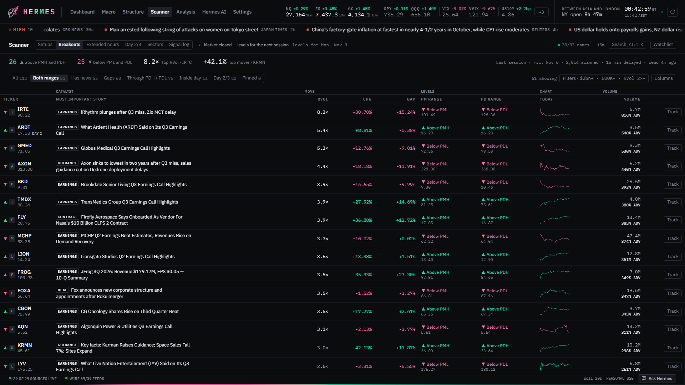
- **The most important story, not the newest** — stories arrive tagged by ticker from
  TradingView's news flow and are graded (earnings, guidance, FDA, deal, contract,
  offering, against an analyst's note or a preview). The newest headline on a big mover
  is nearly always an analyst writing about the move; the Catalyst column shows the
  cause. On the signal log, signals with news behind them reached +2R more often and
  held about three times as much as those without, though no more often reached +1R.
  **And it has to be the company's own story, about something that happened**
  (2026-11-11, when a third of the pinned names led with one that was not): the
  headline's lead names the company, so a market wrap the wire tagged CRWV no longer
  leads CoreWeave's row over its own earnings jump; and a template about any stock (a
  fund-flow line, a fair-value line, "X vs Y: which is the better buy"), the company's
  diary (a conference, a call date, a groundbreaking), a preview, an opinion, a list
  and a recap are held under no name and read by no score. A move is the name's only
  when the name moved. A name with nothing real shows no story. Where the company's
  words are only a guess (a filer's first word, not the table's), a headline that does
  not carry them is left to the feed's tag, so a wrong guess cannot empty a name. A
  round-up (more than three names in its lead) is nobody's, whoever it is tagged with.
  The Dashboard's stock news carries only names on the list or at the pool's $2bn
  floor: the flow is every US listing, and the card had become a micro-cap newswire.
  **A headline's number is held to the name's real move** (2026-11-13): where the lead
  states the name moved 2% or more, the name must have made a quarter of it, the same
  way, since the previous close, or the story is an earlier day's. The evening wrap
  "AMD Jumps 5.9% on Bank of America Price Target" no longer leads AMD's row or scores
  the next morning with AMD flat, nor "Palantir stock falls 19%" (a fall over weeks)
  on a day it is down 2%; a jump that faded keeps its story. **Two analysts, two ways**
  ("China Renaissance Upgraded Apple to Buy. DZ Bank Cut It to Sell") is no direction,
  and another name's call in the same headline ("Intel Upgraded as AMD Downgraded") is
  not this one's.
- **Extended hours** — the pre-market and after-hours gappers of 2% or more, or both at
  once, with the story, the volume against that session's usual and against an average
  day, and both the previous day's and the pre-market's range drawn with price along
  them. The usual session is written down each evening; until a name has five sessions on
  file the figure is an estimate and carries a ~. With no session on it shows the last one,
  for planning the next. **The order is news first, then the move on its volume**
  (2026-11-13): the move in the name's own daily ATRs and the session's share of an
  average day, read as the pool reads the pre-market, so this page and the pool agree on
  who is in play. By the bare percent a 100k-share +15% print sat above a 5M-share +8%
  one. The column header still flips the order to the biggest gaps up or down.
- **Day 2/3** — the big movers, and whether they are still moving. A Day 1 is a 20% move
  on 1.5× volume at $2bn+ by default (the filters reach down to 10% and $300m). Day 2 is
  the session after, whose PDH is Day 1's high; an inside day is the move resting; Day 3
  and on are older. Grouped by side, best first, and written from a ledger the collector
  keeps itself, a session at a time. Its score is a rough order of its own, from where price
  stands against its level, the volume and the news, with no record behind it; the 0-100
  rank needs bars and belongs to the tracked names.

  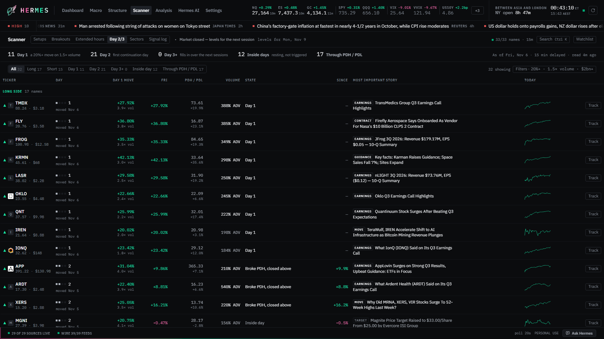

  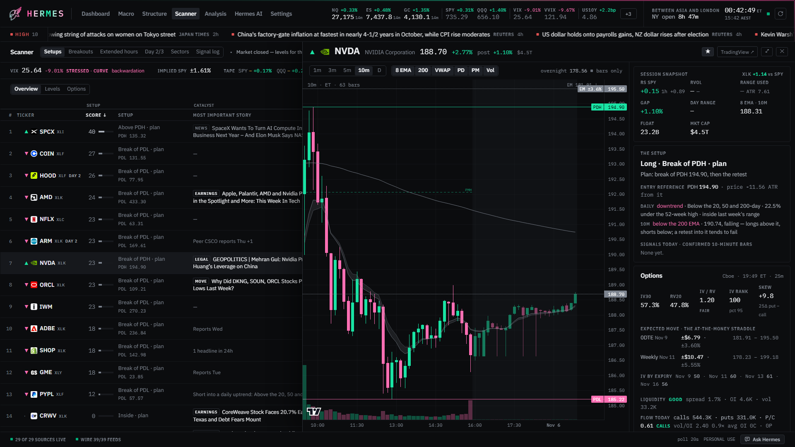
- **Alerts on every tab** — the Pine's alerts, raised by the terminal: a toast, a
  chime (rising for a long, falling for a short) and, once allowed, a desktop
  notification when a name fires an `(L)`, an `(E)`, a ◆ breakout, or gets 90% of
  the way to a level. Only live events alert — a reload or a collector restart never
  replays the morning. What fires, the minimum score and the sound are in
  Settings → Alerts.
- **The signal log** — every signal the engine saw, kept for 30 days with what it
  did afterwards **in R**, where R is the Pine's own stop idea: the best and worst
  excursion, whether +1R came before the stop, and where it stood 30 and 60 minutes
  on and at the close — and a record by group (kind, side, score band). A bar that
  touches both the stop and +1R counts as stopped. **The stop is never counted as
  nearer than a quarter of the ten-minute ATR**, the script's own retest buffer
  (2026-11-11): a signal bar that closes on its low puts the stop idea two cents away
  (GOOGL, 6 Nov: 1R of $0.02 on a $287 stock) or on the entry itself. It reaches 84
  of the 893 settled signals it could be read on, 9%, every one an `(L)`; on the
  script's own stop those reached +1R 30% of the time against 41 to 52% for wider
  stops, and 35 of their 57 stops were on a 5-minute bar that also reached +1R, which
  the bars cannot put in order. It is measured in ATRs, so a quiet stock's floor is
  small (GME's 2.5c stop on 10 Nov is over its floor and stands). The log marks a
  signal *floor* where the buffer is what set its R, the stop shown is still the
  script's, the contract's risk reads the same stop, and signals settled before that
  date were worked again from the bars still held, their first outcome kept. **A
  name that leaves the list during the day is read once more after the bell**, so
  the signals it fired while it was watched are settled like any other's (until
  2026-11-11 they never were: 70 events on 30 name-days sat outside the record);
  what it did after it left is not added. It is a record,
  not a forecast,
  and it says so while the sample is small; it is what the score's weights get
  calibrated against. Every signal now logs the score's parts, and
  `server/tools/fit_score.py` reports the win rate by band, each part's lift and a
  logistic slope — it never rewrites a weight; the record is read and the weights
  changed by hand with its output beside the change. Since the quant audit of
  2026-11-13 each signal also logs what the catalyst read (its grade, which way, and
  whether that came from the name's move, the event's words, the tape or a report), the
  uncapped score and whether the RVOL gate held the name back; and the pool writes its
  own record (`server/cache/pool_marks.jsonl`: its top fifty at each mark, then the day
  each had), so the rank that promotes names can be tested too. Run
  `python -I tools/fit_score.py --since 2026-11-13` from `server/` weekly: it reads only
  the signals on the current weights, and a change is kept only if it holds on both
  halves of the record.
- **A pinned list, and a pool behind it** — the Pine's names by default, up to 40,
  kept by the collector; SPY, QQQ and IWM are always fetched as the benchmarks. A
  symbol Yahoo does not know backs off instead of being retried every tick. **A name
  never leaves the pinned list in silence**: a star that unpins one raises a notice at
  the foot of the page with an **Undo** that puts it back where it sat, and the
  Watchlist editor lists the names unpinned in the last week (in this browser), each
  with when, one click to put back. (A row's star unpins on a single click; on
  10 Nov 2026 that took NVDA off the list unnoticed for a day.) What the
  pinned list leaves of the 40 is filled from **the pool**: every US common line and
  DR at $2bn+ read in one request from TradingView's public screener, gated to the
  names that trade $500m+ on an average day — or have already traded $50m before the
  bell or $500m in the session, or are a strong Day 2/3 — at $10+ with a 1.5%+ ATR (a
  name moving 3% or more on that turnover today passes the ATR gate: its usual range is
  not today's), ranked by the scanner's own in-play arithmetic (the gap in the name's
  ATRs, the pre-market volume against an average day — never yesterday's pre-market
  still sitting in the screener's columns for a name that has not traded yet — a report
  in play, 2 for an outside day by the owner's rule (through the previous day's level
  and the pre-market range the same way; before the bell the previous day's level
  alone) and 1 for the previous day's level alone, 3 for a Day 2 and 2 for a Day 3+ of a 20%
  move, since Day 1's high is the level; past its full mark each of the first two earns
  up to four more, on a log scale to a 3-ATR move and to 40% of a day before the bell or
  400% after it, so the top of the list separates, where it used to tie at 20 and 21) and
  promoted at four marks:
  08:00, 09:00 and 09:25 ET replace the pre-market list whole, 10:00 fills the slots
  they leave for the opening drive, and from then the list holds until the day
  rolls. A promoted row says so, with the mark and the reason; the editor shows
  today's promotions with a pin for any you want to keep, the names in play that
  did not make the cut, and a switch to turn promotion off. A fresh major story that
  is not the report is worth three points in that rank. On the Breakouts and Extended
  hours rows a tag says what the engine will do with the name today: *Pool 09:00*
  with the reason when the pool took it, *In play 6.1* when it is over the pool's bar
  but not on the list, so Track is one click away; a pinned or tracked name shows its
  dot as before.
- **No keyboard controls** — the single-key ones (the number keys for the tabs, A for
  Hermes, F and V on the slide-out, the arrows walking a list) were taken out on
  2026-11-11 with the Settings section that listed them. What is left is what any page
  does: Esc closes what is open, Ctrl+K opens the ticker search (it is written on the
  search box), and Enter opens a row that has the focus.

Relative volume is volume so far against the same time of day on the **ten prior
sessions** (their mean), so a 10:00 reading compares 10:00 with 10:00 — a whole-day
average would read every name as 0.3× all morning, and a single previous day is noise
(the session after earnings reads 0.4× for a name still in play). Breakouts and Extended
hours show TradingView's five-session figure, the one its screener offers. Every "share
of an average day" on the desk — the pool's, the pre-market's, Day 2/3's — is the
thirty-session average. Relative volume starts at the open: Yahoo's pre-market bars
carry no volume, and the column says so rather than guessing.

### Sectors — where the money is, and the stocks in it
Its own tab, after the Scanner (it was a Scanner view until 2026-11-10; it answers a
market question, which group is working, before the Scanner's, which stock and which
level, so it sits on the bar beside Macro and Futures and can stay open on a side screen
all session). **The heat map** — the top mover beside the eleven sector ETFs and regional
banks, ranked, then two dozen theme ETFs, over a day, a week or a month. The bar under a
card is its distance from SPY, and up and down count its stocks at $2bn+, because an ETF
can hide them: XLV closed -0.06% on 2026-11-06 with most of its stocks up. There is no
rotation score. A card opens its stocks below it, with the themes each belongs to, at any
hour: the list's volume filter reads the last whole session. Sectors and nine themes list
every stock in the group; CIBR, SKYY, QTUM, ARKK, PAVE, WGMI, NASA, GRID, BOTZ and TAN are
partial, because Yahoo publishes a fund's top ten and no more; DRAM, URA, COPX, KWEB and
FXI hold mostly foreign listings and TradingView files most American oil producers with
the majors, so those five and XOP list a hand-written set of US-listed names that trade
with the theme, and the page says so. The **Industries** chip swaps the cards for about
ninety groups, ranked by their median stock so that one 40% name cannot carry a group the
way it carries an average. Macro had a rotation panel of the eleven sectors until
2026-11-13; this tab and the Dashboard's rotation row are where they are read now.


### Options — Cboe's chains, read the way a trade is decided
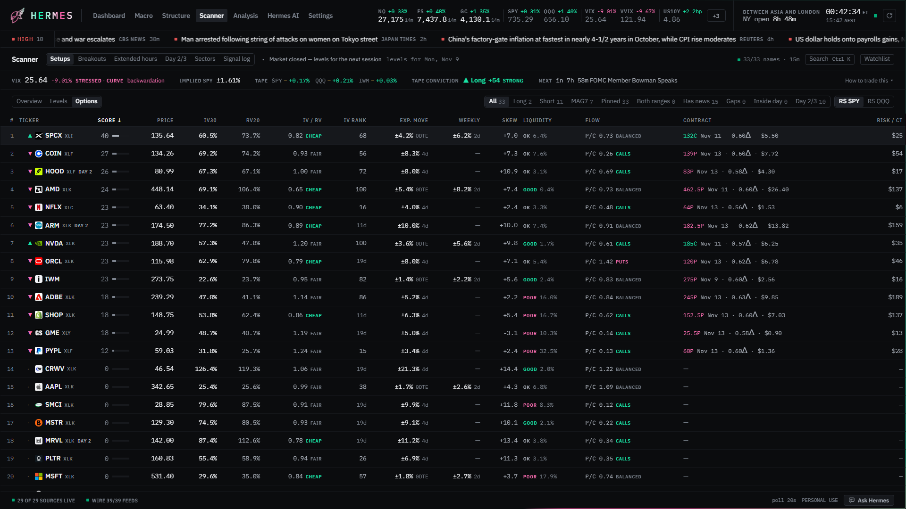

Every scanner name carries its options context, from **Cboe's free delayed chains**
(about fifteen minutes behind, read directly — the index ETFs every five minutes,
single names every ten, one request every ten seconds at most):

- **Is premium cheap or rich?** IV30 against 20-day realised volatility — under
  0.90 cheap, over 1.25 rich — and an **IV rank** that builds from a daily log
  (it says how many of the twenty sessions it needs it has).
- **How far does the market expect it to go?** The front expiry's at-the-money
  straddle as a dollar and percentage band — **0DTE on SPY, QQQ and IWM** when
  one is listed — and the weekly's, drawn on the chart as a dotted band.
- **Can it be traded, and should it be held?** The at-the-money spread and open
  interest graded good / ok / poor, the 25-delta skew, and a warning when earnings
  land before the expiry (implied volatility collapses after the report).
- **The contract.** For the setup's side: a long option at the strike nearest
  0.60 delta, and a debit spread selling the 0.30 delta, each with its premium,
  delta, theta and spread — and **the premium at risk to the setup's own stop**
  (stop distance × delta × 100, an approximation it names). It sizes nothing: the
  risk-per-trade budget that added a contract count, and the switch that turned
  same-day contracts off, left Settings on 2026-11-13. Rules, not advice.
- **The reward half.** Each contract is also priced at the **first target** by the
  plan's own rule — what it is worth there, the reward per contract after half the
  bid-ask, and that against the risk: **the option's own R**, which the stock's
  hides. The structure the engine picks is the one with the better R when both are
  priced, the premium rule otherwise, and the card says which.
- **The earnings number.** With a report ahead: the straddle covering it, net of the
  expiry before it the event alone, against the name's close-to-close moves on its
  last four reports (Nasdaq's dates, the reaction day picked by volume) — dear,
  cheap or about right. And the **term structure**, at-the-money IV per expiry,
  where event premium shows as a front priced above the back.
- **Positioning on the name.** Open interest is logged per session, so the flow
  line reads the change since yesterday on each side and on the busiest strikes,
  and today's chain volume against the name's own twenty-session average —
  **unusual** past twice it.
- **Every figure opens what it means for this trade** — IV30, realised, the premium
  verdict, the rank, the straddle, skew, liquidity, flow and earnings, each read with
  the name's own state (rich says the spread, a rank still building says how many
  sessions it has, a flow leaning against the side says so).

  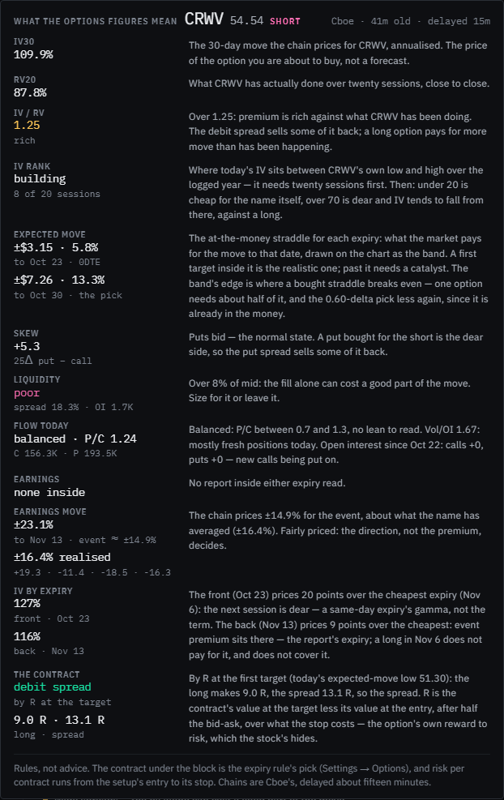

### Scanner → Game plan — the plan, written from the scanner's facts
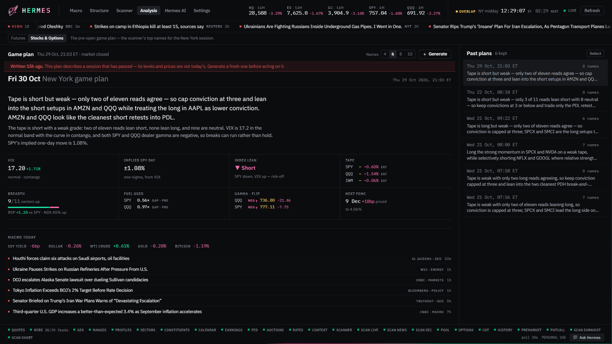

The Scanner's last view (the stocks half of the Analysis tab until 2026-11-11), one
click from the Dashboard's game plan card (*Written plan*). A pre-open plan for the
New York session, generated on demand: pick how many names
(4 / 6 / 8 / 10) and press **Generate**. The collector reads the live scanner into
`facts` — levels, relative strength, the setup, each name's option chain, the tape
count, the weather and today's prints — and the page shows the stages as they run:
*reading the scanner's top names · placing price against PDH and PMH · reading the
option chains · weighing the prints and the tape · writing the plans*. The same
model chain as the futures brief (OpenRouter, free models first, falling through on
failure) then writes only the words. Since 2026-10-27 the generation is a **job** on
the collector that the page polls, so a free model that takes five minutes never
times the page out; a reload mid-way finds the job still running, and a second
press joins it rather than paying for a second model call.

- **The lead** — one line on the tape and what it allows: the count, the cap on
  conviction, and the setups worth taking. Under it the regime in a paragraph, then
  the facts as cards: VIX, the implied SPY day, the index lean, the tape, breadth,
  fuel, gamma and the flip, the next FOMC, macro today and the prints that matter.
- **Per name, last and closed:** the plans come after everything that describes the
  session, one closed row each — the side, the name, the conviction (never above
  the tape's cap) and the plan cut to one line — and a click opens the card: the
  plan in full, the trigger, the invalidation, the first target, **how to express
  it in options** (long or spread from implied vs realised, which expiry, earnings
  inside it), why — each reason naming its layer — and the scanner's facts beside it.
- **The facts beside the prose are the server's**, printed from the scanner, never
  from the model; a plan for a name that is not in the facts is dropped, and every
  number in the prose is checked against the data — any it cannot find is listed in
  an Unverified banner (the same guard as the futures brief).
- Also: the clock (prints, the open, lunch, the close) and the risks, read before
  the plans; the names to leave alone and on watch, after them.
- **Past plans** are kept to judge against the day, with the facts they were written
  from; select several and delete those, or every one. A plan written for a session
  that has passed says so in red at the top — its levels and prices are not today's.

### What the engine computes and what a model writes

| Part | The engine computes | A model writes |
|---|---|---|
| **Futures / Index** | the eleven tape reads, their score and grade and the conviction cap; breadth, fuel, the levels ladder and its confluence bands, which book each wire story reaches, the prints against consensus | nothing |
| **Scanner** | levels, breaks, the setup state and entry, the score and its parts, the daily frame, the catalyst's direction, the signal log | nothing |
| **Options** | implied against realised, the straddles, liquidity, skew, flow, the earnings number, the contract and its R | nothing |
| **Every click-through** | the read of each figure for this name's trade, from stated rules | nothing |
| **Scanner → Game plan** | the facts: every card and every number beside the prose | the plan — lead, regime, per-name plans, what to leave alone, the clock, the risks |
| **Hermes** | the live digest the answer must quote | the answer, every figure in it checked |
| **Hermes AI** | the glance it opens on, and every tool's answer — a scanner row, a ladder, the wire, the calendar, bars, a desk's digest, the latest note | the answer, every figure in it checked against what it was shown or fetched |

---

## The futures desk

NQ, ES, GC, silver (SIL) and WTI crude (CL) across Asia, London and New York: the
**Macro** and **Futures** tabs (the brief is Futures' last view), one bar with the
stocks desk (above).

### The Futures section
**Overview** has the five side by side: price, the bias, the gamma regime, the implied
day and how much of it is used, the nearest level each way and the next release that
reaches each book, with what moves them today, the news that reaches the books (each
story marked with the books it reaches), the vol curve, the book and the sessions under
them. **NQ**, **ES**, **GC**, **SIL** and **CL** are one
contract each: a row of figures; the news that reaches that contract (the Fed, US data
and yields for the indices and the metals, the dollar for the metals and crude, the
megacaps, AI and chips for the Nasdaq, oil and the Gulf for crude, and nothing from
another country's central bank), session ranges, volume profile and gamma, all on that
book; and on the right, where the Scanner's slide-out opens, its chart with
the overnight's high and low, the prior regular session's, the gamma flip and walls, the
settle and the opening range drawn, each 18:00 reopen marked with a hairline (nothing shaded:
on a future the overnight is part of the day), and VWAP with up to three standard-deviation
bands, anchored at 18:00, the London open, 09:30 (built to the 16:00 close, then held) or the
week, from the menu beside the layers. **Brief** is the written brief. Silver and crude have the levels,
ranges, profile, gamma and an implied day (from VXSLV and OVX); the driver-board bias
and the brief are NQ, ES and GC for now.

### The Wire
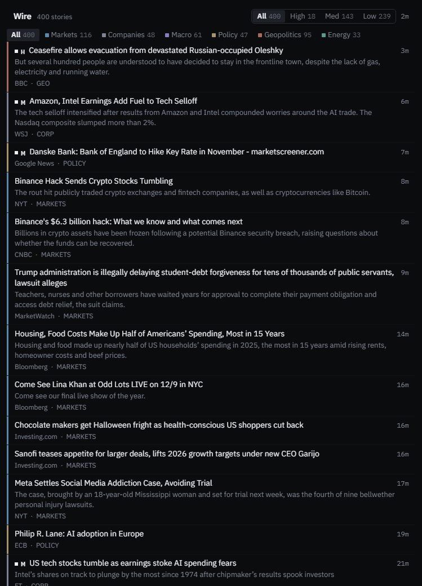

~40 RSS and query feeds (Reuters, AP, Bloomberg, WSJ, FT, CNBC, Nikkei Asia, SCMP,
Japan Times, the ECB, the Bank of England, the RBA and more), merged into one tape:

- **Desk classification** — every headline lands on a desk: `markets`, `companies`,
  `macro`, `policy`, `geopolitics`, `energy`. Title-only classification, because
  summaries lie about what a story is.
- **Impact tiers** — `HIGH` is a thing that *happened*, asked three ways and never by a
  keyword alone: a **decision** (a central bank and a verb doing something to a rate,
  nobody merely saying so), a **print** (a US number and the verb of its release, not
  an official's view of it) or **shooting** (named powers in the headline's own clause
  and an attack, or a shipping chokepoint shut). A central banker talking, a poll, a
  print abroad and a war in the second clause are medium. On 11 Nov 2026, two of the
  fifteen stories on the top tier were events; "Haitian PM praises El Salvador after
  joint strike on alleged home of gang leader" was one of the others, and the CPI
  print itself was medium. Filterable.
- **A story names something a market trades on, or it is not on the tape** (2026-11-11).
  Each headline has to carry a hook: a central bank, a print, rates or a currency, an
  index or an asset, energy, trade policy, the public purse, a company that moves an
  index (or a listing, a takeover, a failure, a deal in billions) or a quarrel between
  powers with a way into prices (a negotiation, an attack, a chokepoint). On every
  feed: the market desks had no test at all, so a measles outbreak, a $150 pie and a
  school bomb hoax rode it. A result of a keyword search has to come from a newsroom
  (the searches returned forecast pages and months-old releases dated that morning),
  a page, a transcript, a press release, a feature about the past and a court's verdict
  on a person are not stories, and an analyst repeating a rating on a company that
  moves no index is the newswire's volume. The central banks' own feeds always stay.
  Stricter than "economic": 176 of the 400 stories on the tape that morning went.
- **The older gates still run first** — the junk lists, the police blotter (a "home
  invasion" is not an invasion, unless the story touches a market figure: violence
  against a CEO has repriced a sector before) and the general feeds' own test.
- **Cross-feed dedupe** that keeps the desk that filed first, encoding repair for
  double-encoded publishers, and section-page detection for query feeds.

### The driver board
On each of NQ, ES and GC in the Futures section, and on the overview's cards: the engine's
score from -100 to +100 with its grade, how many reads can vote now and how much of the
session's weight that is, and the families that carry it. Each cell opens the full
board — every driver a vote with its threshold and its reason, by family, and one line
on how to treat it. The reads fall into three layers: **macro** sets the direction (the 10Y's day change, the dollar,
credit, the VIX and its curve, today's inflation prints, and the index heavyweights'
own prints — what the names that just reported have added to the index since they
traded, past a quarter of a percentage point, is a direction), **positioning** says how
far a move runs (dealer gamma and spot against the flip), **structure** says
whether the tape accepts it (prior value, the last session's range, the daily
frame, the daily 200 EMA, the ten-minute 200 EMA, breadth and the index leaders). A macro lean the structure rejects is named
as a **conflict**, which lowers conviction rather than picking a side. **Event risk**
— the high-impact geopolitics, policy and energy stories since the last cash close,
grouped by story and tagged with the channels each reaches (oil, rates, semis) — is a
damper, never a direction: a strike on Saudi oil is not a short NQ, it is a reason to
be one notch less sure of anything, and it lowers the ceiling by one the way a
conflict does. Under the
votes, the context rows that never vote: the CFTC's **Commitments of Traders**
(leveraged funds for the index futures, managed money for gold, with the net's
percentile of the year), Cboe's daily **put/call** ratios, and OpEx week. The
thresholds are the stocks desk's own where one exists, and the futures brief is
handed the score and may not be more confident than it.

**The score counts only what can vote, and weighs it by session.** A read whose
market is shut or whose input is missing leaves the sum, where a flat read stays, and
the cell says how much of the session's weight is live. Reads that are one idea share
one voice: each family scores its own net, and the families add up by these weights,
which are a judgement rather than a fit to outcomes:

| Family | Asia | London | NY pre-open | NY live |
|---|---|---|---|---|
| Intraday structure (value, last session, 10m trend) | 40 | 35 | 15 | 25 |
| Daily trend (daily frame, daily 200) | 20 | 15 | 10 | 5 |
| Rates & dollar (10Y, DXY, silver on gold) | 15 | 25 | 20 | 15 |
| Risk appetite (VIX, its curve, credit) | 5 | 5 | 15 | 15 |
| Catalysts (inflation prints, heavyweight prints) | 15 | 15 | 25 | 10 |
| Positioning (dealer gamma) | 5 | 5 | 15 | 20 |
| Participation (sectors, index leaders) | 0 | 0 | 0 | 10 |

The stocks desk's tape reads the same way over its own families: index levels 35, risk
appetite 35 and rates & dollar 30 before the open; index levels 35, participation 30,
risk appetite 20 and rates & dollar 15 in the session. Strong is 50 or more with at
least 60% of the weight live, moderate 30, weak 10, and under that there is no lean.
A conflict takes a notch off the grade. On the tape, a lean with under half the weight
able to vote is weak at most and is printed with its count: overnight only SPY and QQQ
against their levels can vote, and "Long +100, moderate" on those two reads of eleven
now reads *Long · 2 of 11 reads · weak*, with plans capped at three.

### Session ranges, volume profile & dealer gamma
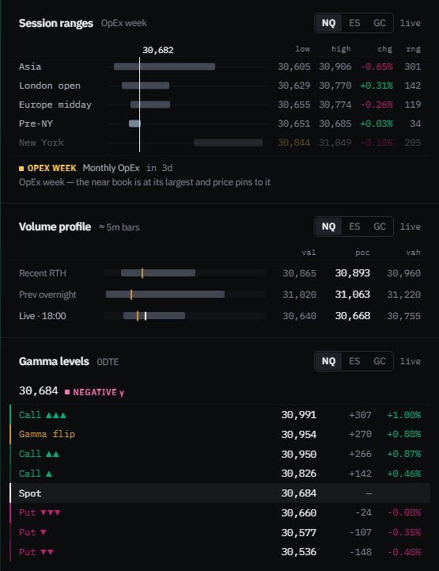

The core of each book's view in the Futures section: three panels, one price ladder
each, all on the book the view is for.

- **Session ranges** — the four boxes a trader draws, in ET: Asia 20:00–00:00, London
  02:00–05:00 (on London's clock, 07:00–10:00), the pre-market 04:00–09:30 and New York
  09:30–16:00 — what each traded, from true 5-minute highs and lows, every bar on one shared price axis with the current price as a single line through all
  of them. A staircase is a trend, a stack is a range; a high or low printed in amber has
  been taken out — the handover read. Rows that are still yesterday's are dimmed. Under
  the rows, **fuel**: today's range so far against the 14-day ATR and the expected move,
  and whether it was spent overnight or in New York — has the book already done its day's
  work before the open?
- **Volume profile** — POC, VAH and VAL for three windows cut the way sessions are
  actually traded: the **previous RTH** (09:30–16:00 ET) as every session's reference,
  the **completed overnight** (18:00–09:30) once New York is trading, and a
  **developing profile** anchored at 18:00 ET through Asia/London and re-anchored at
  09:30 at the cash open. Each row draws its value area as a band, its POC as a tick,
  and live price as a marker. Built from 5-minute bars and labelled `≈` because that
  is what it is: zones, not ticks. Under the rows, **the read in words**: where the
  session opened against prior value and where price trades now — acceptance,
  the failed break and the 80% rule, the rotation day — with the prior session's
  shape (P, b, D, two distributions). The sentence opens the market-profile rules
  it is read by.
- **Gamma levels** — the seven prices where dealer hedging turns: three call walls,
  three put walls and the gamma flip for the **0DTE book**, with the regime badge
  (positive γ dampens moves; negative amplifies). Rank is drawn as chevrons —
  `▲▲▲` is the heaviest wall, not a footnote number. Sourced from a separate options
  analytics service over HTTP; if that service is down, this panel says so and shows
  nothing, because a stale gamma level is worse than none. Under the regime, **one
  sentence**: spot against the flip in points and in the book's own one-sigma day,
  the regime's rule (fade into the walls, or trade the break), the walls either
  side, OpEx week — and it opens the dealer-flow rules behind each.

**Will New York trend or range?** A record first, a call later. `daytype.py` labels
every finished New York session by the ladder's own rule (1.2 ATR or wider and closed
in its outer fifth is a trend day; 0.8 ATR or narrower a range day; the rest normal;
inside when it sat inside the session before), and `server/tools/daytype_backfill.py`
labels two years of them per book — the cash ETF's hourly bars for the session, the
future's for the night and for the yardstick, its own Globex-day ATR, the one the
ladder measures by — and prints the base rates with their counts, condition by
condition: what yesterday was, the night's size, Asia's, London's, the gap, where
09:00 sits against yesterday's range, the VIX band, the weekday. What 569 sessions a
book (2024-07-12 to 2026-11-09, as far back as the futures' hourly bars go) said: a
trend day is one session in fourteen on NQ (39) and ES (41), a range day three in
five. The night's size is the one thing that separates them — after a night under 0.4
ATR, 2 of NQ's 142 sessions trended and 108 ranged; after a night of 0.8 ATR or more,
12 of 117 trended and 51 ranged (ES: 4 of 168, then 17 of 114) — while yesterday's
shape mostly says that range begets range (16 of 349 sessions after a range day
trended; a quiet night after a range day trended once in 114 on NQ, once in 129 on
ES). Gold's New York box almost never trends by this rule (10 of 573), because gold
does its moving overnight; its rows show the counts and rarely a call.

The lean is on the pages as counts, never as a probability. The Futures Overview's
**Session type** card gives each book a row: the call — *Range day likely*, *Trend day
more possible*, *Mixed record* or *No lean* — the night so far in the book's own ATR
and yesterday's shape, and under it the conditions that carry the call with their
counts (*quiet night (0.31 ATR so far): 2 trend days in 142, 108 range*); a click opens
every condition that holds today with its count, which of them vote, and the base rate.
A condition votes only with fifty sessions behind it and a lift worth the name (range
ten points over the base rate, trend one and a half times it); the call is the side the
votes agree on. After the close the row says what the day was. Each book's overview
card carries the same line, the Dashboard's game plan carries it for NQ and ES, the
brief's digest carries it as `session_type_lean`, and Hermes reads it as the
`session_type` panel. The Scanner's strip showed it for a day and no longer does: it
is a read of the futures' night, and that page is stocks and options. The record behind it is the backfill's sessions plus
the live log's own: since 2026-11-10 the collector writes one card per book at 09:25 ET
— the night's boxes in ATRs, yesterday's shape, the fuel, the vol curve, the gamma
regime, the morning's prints — to `cache/session_types.jsonl`, labels it after the
close, and counts each labelled day into the tables, so the lean is checked against
its own record as it goes.

### The session clock & the vol curve
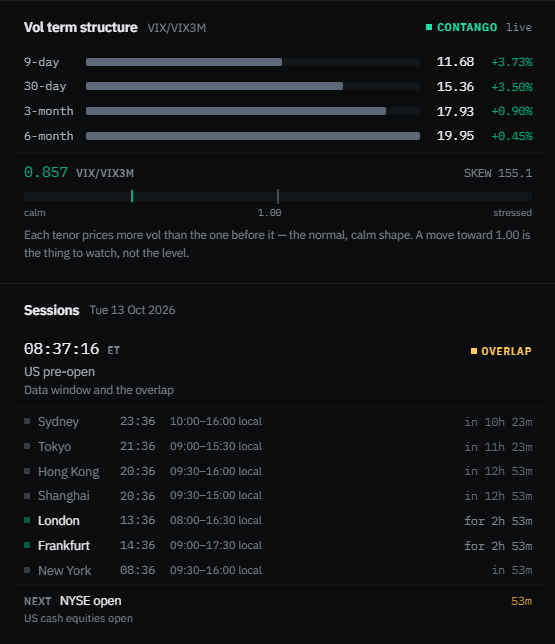

- **Sessions** — the same four boxes as the session ranges, each with its ET window,
  the window on your own clock, and a countdown to its open or close; a phase headline
  (*"London into the pre-market — both boxes open"*) **read off the same boxes**, so it
  can never contradict the rows beneath it; the hour from 02:00 ET until London's box
  opens reads **Frankfurt**, Europe's first hour, and the week is bounded by Globex
  (Sunday 18:00 ET is Monday morning, not the weekend). The NEXT marker counts down to the box
  boundaries — and shows an FOMC entry **only when the Fed's own calendar says there is
  one**. NYSE **holidays and half days** come from one
  table checked against the exchange's own calendar (Thanksgiving reads as a holiday,
  the day after closes at 13:00), countdowns skip weekends, and London's markers run
  on London's clock — so the weeks when the UK and the US change DST on different
  Sundays no longer put the London open an hour out.
- **Volatility** — the VIX curve (VIX9D → VIX → VIX3M → VIX6M plus SKEW) with the
  VIX/VIX3M ratio drawn against 1.00: contango is the calm shape, backwardation the
  stressed one, and the crossover usually leads the index rather than following it.
  Under it, the **implied day** per book: the one-sigma move in NQ, ES and GC's own
  points from VXN, VIX and GVZ, how much of it today's Globex range has used
  (room / normal / stretched) and implied against twenty-day realised (cheap / fair /
  rich) — the stocks desk's own thresholds, so the two desks agree — with GEXYGEN's
  narrower 0DTE band beside it when that is up. Each row, and every VIX figure, opens
  the bands and what they mean for the desk.

### Rates, the policy path, and the FOMC meeting-by-meeting read
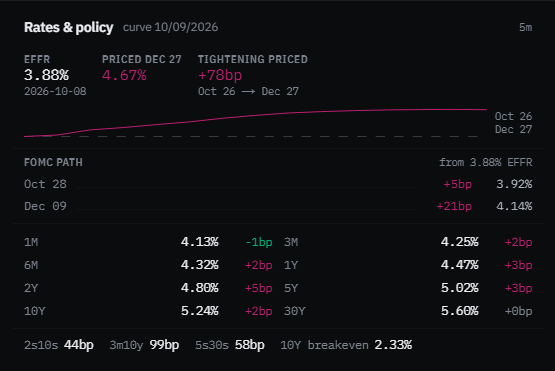

- The Treasury **curve** (1M→30Y) with daily basis-point changes, the classic spreads
  (2s10s, 3m10y, 5s30s) and the 10Y breakeven.
- The **fed funds futures strip** (15 months of ZQ contracts) rendered as the market's
  expected policy path.
- **FOMC path** — the strip un-mixed against the Fed's actual meeting dates into
  **basis points priced per meeting** (`Sep 16 +17bp → 3.79%`). Never "a 72% chance of
  a cut": probability framing needs an assumed move size, and this never assumes one.
  The one convention (day-count around mid-month decisions) is documented and tested.
  The path and the spreads open **what they mean**: the next decision in words, what
  the day's move in the 10Y does to each book, what the curve's shape says.
- **Cboe put/call** — the daily total, index and equity ratios with the log's
  twenty-day average, on the Volatility panel of both desks; a sentiment read for the
  week, never a timing tool for the open, and it says so.

### The book, index movers & sector rotation


- **The book** — NQ/QQQ, ES/SPY, GC/GLD, YM, RTY with day-range position bars and
  sparklines.
- **Index movers** — the top ~40 NDX/SPX names by **contribution** (weight × return),
  as a heat-map or ranked list, with the honest footer: how much of the index the
  shown names are, and what they added to it today. "NQ is down" and "NQ is down
  because two names are" are different facts.
- **Sector rotation** *(off the Macro page since 2026-11-13: the Sectors tab and the
  Dashboard's rotation row carry it, and Hermes reads it as before)* — the eleven S&P
  sector ETFs as **excess return vs SPY** (the
  only view that says anything on a day when everything is red), plus the breadth
  line: equal-weight against cap-weight, i.e. is this move the market or just its top.
  Each sector's row names its leading and lagging stocks on hover; the two dozen theme
  ETFs read the same way are the Sectors tab's cards.
- **Breadth** *(off the Macro page since 2026-11-13: it is the Dashboard's card)* —
  every US stock at $2bn+, advancers against decliners, by the size of the move.

### Calendar, Fed & Treasury diary, earnings
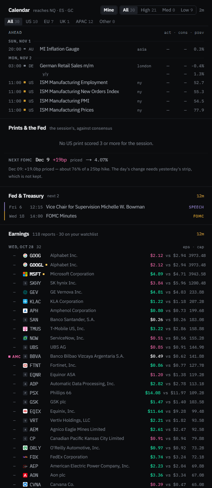

- **Economic calendar** — impact-scored, region-filterable (US/EU/UK/APAC), each event
  tagged with the trading session it lands in, and a `MINE` filter that narrows to
  releases that actually reach NQ, ES or GC. Three figures per row — `act · cons ·
  prev` — because markets move on the gap between actual and consensus, not on the
  number itself. Once a print lands it carries its **read** — hot (the stronger
  economy), cold or in line — and the chip opens what that means for NQ, ES and GC,
  by theme: a hot CPI through the discount rate, a hot payrolls through the Fed, in
  the server's words, the same ones the driver board counts.
- **Fed & Treasury** — one diary of scheduled US rates risk: FOMC meetings, the Beige
  Book, governor speeches and testimony from the Board's own calendar, merged
  chronologically with **coupon auction supply** (3Y/10Y/30Y, reopenings named what
  the market calls them) from TreasuryDirect — because a tailed 30Y at 13:01 ET is an
  equity event for the longest-duration index on the board.
- **Earnings** — the coming week's large caps ($50bn+ and bellwethers), BMO/AMC
  tagged, estimates marked with an `e`, and actuals shown against the estimate and
  coloured by the surprise once they print.

### The AI session read


**Futures → Brief** generates a **pre-session brief** on demand: pick the session (Asia /
London / New York / auto-by-clock) and the book (NQ / ES / GC / all three). The
collector computes every table on the page from the live snapshot, then an LLM (via
OpenRouter, with a model-and-mode fallback chain) writes the read around them — as a
job the page polls, like the game plan, so no request is ever as long as the
generation. Top to bottom:

- **Partial data** — which sources were down when it was written, so a missing level
  is a stated gap rather than a silent one.
- **Thesis and calls** — the one idea of the day, then a card per book: the call at
  the open with its conviction, the rest-of-day lean, the price that makes it
  wrong, and the **catalyst** it rests on — a heavyweight's print or an event since
  the close, cited by id from the facts below.
- **Snapshot** — the books, the dollar, the 10Y (and the real yield for gold), vol,
  oil and the yen, with week and month context; the model flags the rows to watch.
- **Levels** — a ladder per book in price order: gamma flip and walls, the
  expected-move band (GEXYGEN's own, or a one-day 1σ from VXN / VIX / GVZ when it is
  down), the overnight or handover range, prior-RTH high / low / POC and settle, each
  measured from last.
- **Dealer gamma** — regime, the flip's distance in percent and in expected moves,
  the walls.
- **Heavyweights & event risk** — one row per big index weight, any name whose move
  alone is worth a tenth of a percentage point of the index, and any name that just
  reported: weight, move, its contribution in percentage points, the print and the
  one headline that explains it; under them the
  high-impact geopolitics, policy and energy stories since the last cash close. The
  driver board votes the prints and damps conviction under the events (above), so a
  megacap's miss lowers the board's ceiling before the model has to notice the join
  itself.
- **Catalysts** — data, the Fed (with what each FOMC has priced), long-end auctions
  and bellwether earnings, from twelve hours back to three days out; the model notes
  the ones that matter.
- **The read** — per book: the regime, the macro transmission as a chain of causes,
  the open, the invalidation, the rest of day, what flips it, and drivers tagged
  bear / bull / mixed / neutral.
- **Rotation** — six equity ratios (or GDX/GLD and gold/silver) with five-day
  direction, the megacaps' moves, and the model's read of the tape.
- **Headlines that move price** — picked from the wire by id and tagged with the books
  they move.
- **Past calls** — every prior brief kept with its full digest and tables attached, so
  any call can be audited against exactly the data it saw.

The design principle throughout: **the engine computes, the model narrates.**

- The tables are never the model's. The page prints them from computed facts, and the
  model's notes join onto rows by id — a note pointing at an id that does not exist is
  dropped before it is stored.

- The digest is scoped to the chosen book — the instrument's own data is one block,
  everything else is explicitly `context_only`, because structure is obeyed where
  instructions are merely read.
- Headlines are re-weighted to the session's home region; the calendar block tags
  which events land inside the session being written.
- The volume-profile block states the market-profile reads **as computed facts**:
  each window's shape (P / b / D / double distribution), where the session *opened*
  relative to prior value, and where price trades *now* — above value, inside, or
  below. The model is told to cite the classifier's decisions, not to re-derive them.
- Every claim in the note must quote a figure from the digest; a hedged guess
  presented confidently is treated as worse than no note — and that is **checked**,
  not hoped for: every number in the model's prose is matched against the digest,
  the model is asked once more if any are missing, and any that survive are listed
  in an **Unverified figures** banner above the note.
- A source serving a stale cached copy when the note is written is named in the
  **Partial data** banner with the copy's age, so a brief is never written on frozen
  prices without saying so.

Reports persist to disk with their full digest attached, so any note can be audited
against exactly the data it saw.

---

## Hermes AI

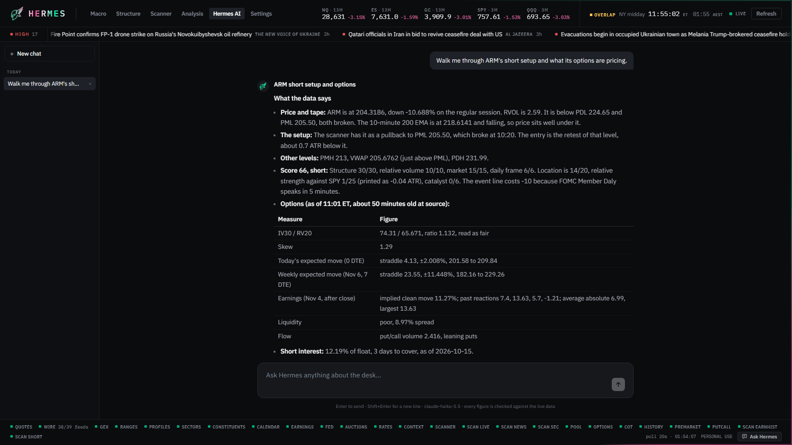

The assistant with the whole terminal in front of it, on a tab of its own after
Sectors, laid out like the chats you know: past chats down the left, the thread in
the middle, the box at the bottom. It is not a chatbot with a market feed pasted in.
It opens on the desk at a glance and fetches the rest through **tools** the collector
serves — the same figures the panels print — and every number in its answer is
checked against what it was shown or fetched.

### What it reads

- **The glance it opens on** — the clock, the strip, each book's driver board, event
  risk, the index heavyweights, every name reporting today, the top headlines, the
  scanner's leaders and the latest notes, a few thousand tokens in all.
- **Tools for the rest**, every one on every question, written for a model to read: one
  line per headline, release or bar, so a row costs a third of what the panel's JSON
  would. A panel's list comes back whole, not its first few rows. Each call shows under
  the answer while it runs.
- **A question across names starts with the table.** Which name is closest to a break,
  which options read is cleanest, the strongest or the weakest: `scanner` first, then
  `scanner_row` for the names it singles out. Nothing is called missing before the
  tool or panel that holds it has been asked, and a digest too big for one answer
  names the panels for what it left out.
- **Your settings travel with each question** — the alert choices from Settings,
  so an answer about alerts reads them as you set them.

| Tool | What it returns |
|---|---|
| `scanner` | the whole Scanner table, one line a name: score, setup and entry distance, the breaks and progress toward the rest, the day's move, relative volume and strength, the 200 EMA side, the options read and earnings; sorted by score, nearest a break, nearest an entry, strength, volume or move |
| `scanner_row` | one name's whole row: last, the levels, what has broken, the setup and entry, the score and its parts, the options read (implied against realised, the expected move, the suggested contract), earnings, headlines and filings |
| `bars` | a name's recent ten-minute or daily bars, with the EMA wave, VWAP and the levels |
| `levels` | a book's live ladder: prior settle and RTH, the overnight, today's opens, both VWAPs, the opening range, the expected move, the walls and the flip, each with its distance from last |
| `heavyweights` | what is moving the index name by name, with its contribution in percentage points, the print if it just reported and the headline that explains it |
| `event_risk` | the high-impact geopolitics, policy and energy stories since the last cash close, with the channels each reaches |
| `earnings` | the Earnings panel in full, by day or for one name: every report with its time, estimate, result, surprise and size |
| `wire` · `calendar` · `sessions` | the wire searched or filtered by impact, one day's releases, the session clock with every exchange |
| `digest` · `note` | a whole desk's digest, and a brief or game plan with its age, whole or for one book or name |
| `panel` | every other panel on every tab, by name: the macro board, the scanner's regime strip, the driver board, session ranges, the session type (will New York trend or range, as counts), value, gamma, volatility, the expiries, the COT, the tape count, breadth, fuel, index options, today's prints, rates and the Fed path, the Fed diary with every speaker, cross-asset, sector rotation and themes, market breadth, all forty index movers, sector peers, the catalysts, the scanner's pool, signal log and record, Breakouts, Extended hours, Day 2/3, the stock news, the Dashboard, the sector heat map and any one group's stocks, past notes and source health |

### How it answers
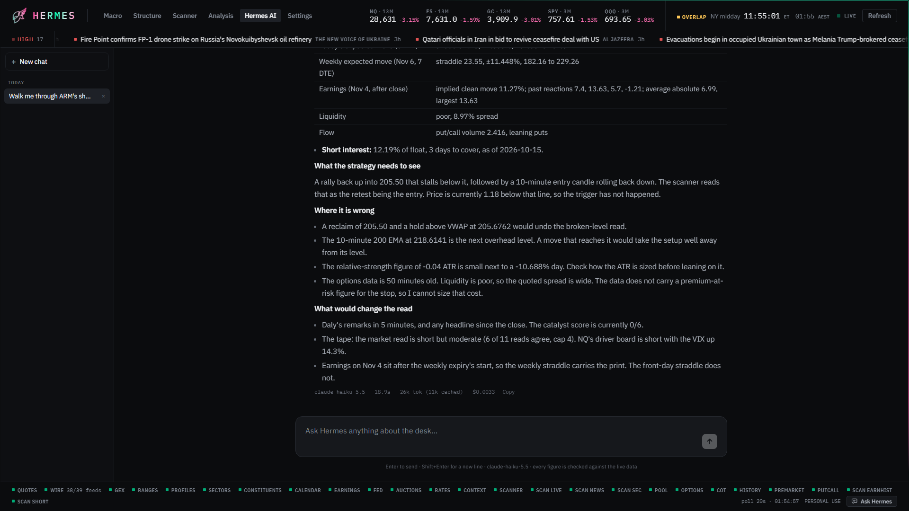

- **A question about a trade comes back in four parts** — what the data says, what the
  strategy needs to see, where it is wrong, what would change the read. Answers may
  run longer here than in the side panel and carry headings, bullets and tables.
- **Every figure is checked.** A number the model was not shown and did not fetch is
  named under the answer; a figure carried from an earlier answer is flagged apart
  from an invented one, and an index name is not a figure.
- **Old notes are dated.** The latest brief or plan carries its age; past a few hours
  the answer says how old it is before quoting it, and where the live ladder has
  moved since, it quotes the live figure.
- **The footer** under each answer shows the model, the time, the tokens it took, how
  many came from the provider's cache, and the cost.
- **Long chats stay coherent** — past twenty-four turns the older ones fold into a
  short summary the next question carries. Chats are kept in this browser only.

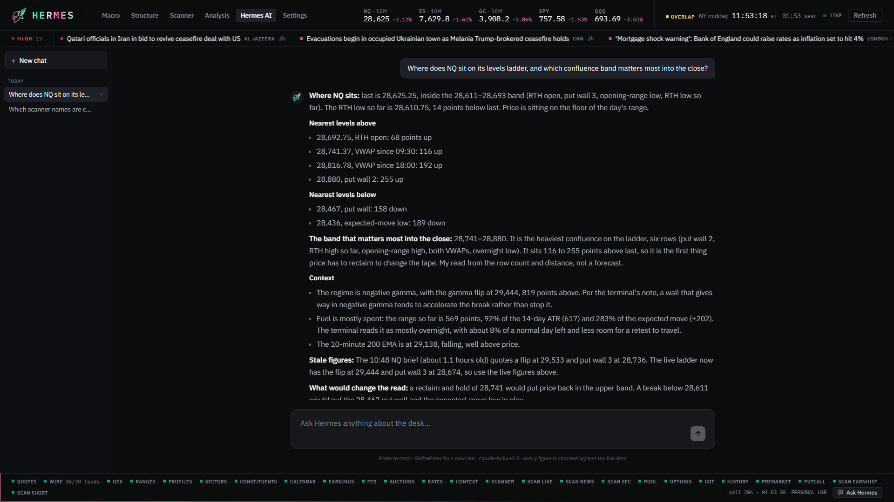

### The router

A router in front of the model decides how much thinking a question gets. It never
decides what Hermes can reach: every question has every tool.

- **No model at all** — a handful of checks (the phase, whether a box is open, a strip
  quote) are answered straight from the glance.
- **Quick** — no thinking and a shorter answer.
- **Full** — a name, a level, a why or a comparison gets the thinking budget. Every
  follow-up is full.

The fixed start of the prompt is the same bytes every time and is marked for the
provider's cache, which an Anthropic model needs telling about. `npm test` runs the
router's tests.

### The model

`NT_HERMES_MODEL` runs this tab alone on a model you name, paid from your OpenRouter
credit; unset, it uses the same free chain as the notes and the panel. The model must
support tool calling. `scripts/hermes-bakeoff.mjs` puts the tab's own prompt and tools
to several models and writes a report with each answer's time, tokens, cost and
unverified figures. The first run, eight questions across both desks, is in
[`docs/hermes-bakeoff-2026-10-30.md`](docs/hermes-bakeoff-2026-10-30.md):

| Model | Answered | Avg time | Tool calls an answer | Unverified figures | Cost, all eight |
|---|---|---|---|---|---|
| nvidia/nemotron-3.5-super-vl:free | 8/8 | 49.5 s | 2.1 | 1 | $0.00 |
| anthropic/claude-haiku-5.5 | 8/8 | 14.8 s | 2.3 | 3 | $0.03 |
| google/gemini-3.8-flash | 8/8 | 12.0 s | 2.1 | 1 | $0.12 |
| deepseek/deepseek-v4.1-flash | 8/8 | 10.7 s | 3.3 | 1 | $0.02 |
| deepseek/deepseek-v4-pro | 8/8 | 34.8 s | 3.4 | 8 | $0.17 |

### Beside any tab — the side panel


The terminal's assistant, in a panel beside the page rather than over it: the **Ask
Hermes** key on the status rail, or `A`. It answers from the desk's live digest —
the same facts the plan is written from, plus the tab on screen and the Scanner's
selected name — and reaches the rest of the terminal through the same tools as the
tab. If no model in its chain will work through tools, it answers from the digest.

- **Openers follow the tab, and the desk.** On Macro: *what matters most going into
  the next session? what are rates and the Fed path telling me? which headlines could
  move NQ, ES or GC?* On Structure, stocks side: *what is the tape count saying, and
  why? is breadth confirming the move? how should VIX shape my stops today?* — and on
  the futures side the ladder, the gamma regime and the term structure. On the Scanner
  with a name selected: *explain its setup · what would trigger and invalidate it ·
  which contract fits it and why · why does it rank where it does.* On the Scanner's
  Game plan view: *summarise the game plan · which name has the best context · what
  would change the plan at the open · explain the conviction cap* — and on Futures'
  Brief view, the brief in three lines and what would make today's calls wrong.
- **Every figure in an answer is checked** against the data the model was shown; any
  it cannot find is named under the answer, shown and marked rather than passed off.
- The thread survives closing the panel, and which model answered, and how long it
  took, is printed under each reply.

---

## Why this exists

I trade US stocks and ETFs through options in the New York session, on one
strategy: a break of the pre-market or previous-day high (low), entered on the
retest — or on VWAP / the 8 EMA when price runs too far. The questions before the
open are always the same: is the tape with me, which names are strongest against the
market, which levels are they about to break, and what are the options pricing?

I also trade **NQ, ES and GC** futures across the **Asia, London and New York**
sessions, where the questions are different: what happened while I was away, what is
scheduled to happen while I'm trading, where are the levels that matter, and what
regime am I stepping into? Answering either set meant a dozen tabs — news sites, an
economic calendar, a rates page, a charting platform, an options dashboard.

Hermes folds all of it into one screen, in the spirit of an institutional terminal:
**everything states its own age, its own source, and its own limitations.** Every
figure that changes flashes. Every panel answers exactly one question. And an LLM
writes a session note at the end — but only from facts the engine has already
computed, never from vibes.

It is named for Hermes: god of messages, information and speed, which is the whole
job description.

---

## The screen

One tab bar for both desks — **Dashboard** · **Macro** · **Futures** · **Scanner** ·
**Sectors** · **Hermes AI** · **Settings**; `1`–`7` move between them and `A` opens
Hermes. There is no desk switch: the futures brief is Futures' last view and the
stocks game plan the Scanner's. Both desks and Hermes AI are walked above. On the Macro tab,
three columns on one session clock:

| Column | Question it answers |
|---|---|
| **Left** | *What is the market doing?* — index movers, earnings with the watchlist marked, rates & the policy path, the macro board |
| **Middle** | *What is happening?* — the wire: ~40 feeds, classified, deduplicated, impact-ranked |
| **Right** | *What is scheduled?* — the economic calendar, today's prints and the Fed path, the Fed & Treasury diary, the sector peers reporting, cross-asset moves |

The Futures section and, until 2026-11-13, the Scanner's Index view are the other three
questions, the futures and the index respectively: *where are we?* — the book, session ranges,
the volume profile (with **yesterday's shape** under it: trend day or range day, the
close in its range, the gap at the reopen) and a live **levels ladder** per book (prior
settle, prior RTH, the overnight, today's opens, VWAP from 18:00 and from 09:30, the
opening range, the expected move, the walls, the ten-minute 200 EMA, with **confluence
bands** where three or more rows sit inside a quarter of an ATR and the daily 200 EMA
as the regime line) — its main rows drawn on each book's chart and the whole of it read
by Hermes's `levels` tool, since the panel that listed it gave its place to the news
that reaches the book — and the index ETFs' own levels; *how is it positioned?* —
dealer gamma for the futures and in ETF prices, and the index ETFs' options; *is the
tape with me?* — the vol curve, the tape count, breadth, fuel and the session clock,
under the driver board.

Above them: one band, the tabs in its centre and on its right the time in New York *and*
in your own zone with the countdown to New York's open or close; on the Macro tab, a crawl
of only the **high-impact** headlines. The prices sit on the pages that use them: the books
on Futures, the macro on Macro's board, SPY, QQQ, IWM and VIX in the Scanner's masthead,
and all eleven (NQ, ES, GC, SPY, QQQ, VIX, VVIX, the 10-year, the dollar, crude, bitcoin) in
one row atop the Dashboard. Below: a status rail on one line —
how many of the data sources are live, which opens the whole list with each one's age,
and anything down or serving a **stale** cached copy named with its error and age (red,
or amber for stale) — because a terminal that hides a dead feed is lying to you.

---

## The chassis

**Quiet Terminal is the default interface** — GEXYGEN's flat chassis, carried
across by copying (never by linkage): one neutral grey ramp, hairlines instead of
cards, sentence-case section titles, condensed caps labels, square markers, IBM
Plex Sans / Condensed / Mono, and a header of one band with the tabs centred on the
window: the clock on one line from 1,700px wide, stacked tighter below that. The data hues are
the only colour on the screen. Its ground is a shade lighter since 2026-11-11 (#101114,
from #0b0c0e), the surfaces, hairlines and grid with it, so nothing stands off it
differently.
**Luminous Glass** began as GEXYGEN's other interface, carried across the same way,
and was turned up on 2026-11-11: a deep ground lit from behind by the two chrome hues,
and every block a rounded card of glass floating on it with air between — the band,
the crawl, the modules, the stat rows, the tables and the status rail — all in one
flat tone, the light showing around and between them. A row of figures at the head of
a page (Setups, Breakouts, a Futures book, the Sectors tally)
is one card with a short rule between its figures, never a row of separate tiles
(2026-11-11; Day 2/3 and Extended hours already drew it so). The band under the
header (a page's views, its quotes and its search) is not a card of its own on
Sectors, the Scanner and Futures: it is the top of the card below it, a rule between
the two, and the Futures overview's five books are columns of that card. It stays a
card where nothing of its own width sits under it (a written plan or brief, Settings,
the Watchlist editor while open); the Dashboard's quote strip and Macro's crawl are
cards as they were. A page that has not answered
yet is a card too, with the helm in the middle of it, never the header and the status
rail with bare ground between. Tabs, view switches and chips are pills and the one you are
on is lit; a chip bar sits on the table it filters as one card; the text is the
system's own plain sans (Segoe UI Variable on Windows 11) with JetBrains Mono for
figures. **On a window 2,200px wide or more everything is drawn 10% larger** (CSS
`zoom` on the frame, with the charts set back to 1:1 so they stay sharp); on a 1920
screen it is the same size as before. The gap between cards is 8px. It rides on
Quiet's layout — `<html>` wears `ui-qt ui-lum` — so every page and strip is the same
and only the paint changes; the blocks carry class hooks (`qt-mast`, `qt-stats`,
`qt-bar`, `qt-sheet`, `qt-card`, `qt-frame`, `qt-wait`, `qt-slab`) that Quiet gives
no paint.
Those are the two interfaces, chosen in Settings → Interface. **Classic**, the carded,
neon, mono-caps chassis this terminal shipped with, was a third until 2026-11-11, when
it was removed: it cannot be chosen, and a cookie that still names it opens Quiet. The
stylesheet's unscoped rules, which were Classic's paint, remain as the base that
`.ui-qt` and the `qt:` variant paint over. Settings is one tab per section: Interface,
Alerts and Presets. Options (a risk-per-trade budget and a same-day contracts switch),
Frame light, Data hues and Chrome (a hue picker per slot) were removed on 2026-11-13; a
preset sets every hue at once, and a hand-mixed palette from before keeps drawing as
"custom" until a preset replaces it.

**Navigation** is the top bar: the pages as tabs, the Scanner's views in a strip on its
page. (A sidebar that listed every page and view sat behind a setting from 2026-11-09 to
2026-11-11; the top bar was kept and the sidebar taken out, so one navigation is all there
is to keep working.)

Either way: three-hue discipline (a colour on a figure means calls, puts, or the
flip — decoration lives on its own tokens), a plain frame (the animated light that
ran its edge was removed on 2026-11-13), a wordmark and helm that wash on one shared
cycle, and a change-flash on every figure that
ticks. Themes are configurable, per-panel filters persist in `localStorage`, and
the whole board is keyboard-free by design — it is meant to be *read*.

---

## What it gathers

| Source | What | Cadence |
|---|---|---|
| Yahoo Finance (spark) | 50+ instrument quotes: futures, ETFs, FX, rates, vol complex, global indices, crypto | 20s |
| Yahoo Finance (chart) | 5-minute OHLCV bars for NQ/ES/GC → session ranges & volume profiles | 1–5 min |
| Publisher RSS + query feeds | ~40 feeds across six desks, region-tagged | 2 min |
| Nasdaq | Economic calendar (consensus/actual/previous), the earnings calendar and each watchlist name's pre-market volume. **When Nasdaq refuses** (it did from 05:49 ET on 10 Nov 2026, and the desk went through a CPI day with no CPI on its calendar) **TradingView stands in**: its economic calendar for the releases, each title put into the names Nasdaq uses so the tiers, themes and release families still read it, with the Fed Board's own speeches added because it lists none; and its screener for the earnings list (the report's date, before or after the bell, the EPS and the estimate; its EPS can differ from Nasdaq's). The status row says which is in use, Nasdaq is asked again every half hour and takes over when it answers, the pre-market volume, high and low fall back to the wide read's (stocks only: SPY, QQQ and IWM are not in that read, so they have no stand-in) and the pre-market source then counts as live on the status rail with a note saying whose figures they are, red only when neither answers, and with neither the calendar keeps its schedule for two days marked stale and a page with no calendar says "Calendar feed down", never "None scheduled" | 10 min |
| U.S. Treasury (yields) & fed funds futures | The curve, spreads, and the ZQ strip | 30 min |
| Federal Reserve (`calendar.json`) | FOMC dates, speeches, testimony, Beige Book | 1 h |
| TreasuryDirect | Upcoming coupon auctions | 6 h |
| iShares holdings CSVs | NDX/SPX constituent weights → contribution math | daily |
| Yahoo Finance (chart, per stock) | 5-minute bars 04:00–20:00 for every watchlist name → the Scanner's levels, wave, VWAP and signals; daily bars for the ATR, the official PDH / PDL and the official open | ~90 s a name in session (SPY/QQQ/IWM 30 s), 15 min closed; daily 6 h, and again just after the open and after the close |
| TradingView (public screener, one POST) | Every US common line and DR at $5bn+ with close, change, volume, 30-day average volume, 14-day ATR, pre-market change and volume, report dates → the Scanner's pool and its promotions | 5 min 04:00–10:30 ET, 30 min otherwise |
| Yahoo Finance (live quote stream) | Every trade for the watchlist, the wide scan's best few hundred names and any open chart → the last candle and each name's last price | pushed, about 2 s behind |
| Yahoo Finance (quote summary, fund holdings) | The top ten holdings of the theme funds no industry describes → the stocks a Sectors card lists | one fund a tick, each once a week |
| TradingView (public screener, the wide read) | Every US stock and DR at $300m+ with the day's bar, the two previous sessions' bars, pre-market and post-market figures, float, industry and the week's and month's change → Breakouts, Extended hours, Day 2/3, Sectors and Breadth | 2 min 04:15–20:15 ET, 30 min otherwise; 15 min delayed |
| TradingView (public news flow) | US company stories tagged by ticker → the Catalyst column, with one per-name read for the top of the wide scan | 2 min in session, 15 min otherwise; per name 15 min |
| Yahoo Finance (per-ticker RSS) | Each watchlist name's headlines | 10 min a name |
| Cboe (delayed option chains) | Each watchlist name's chain → IV, the straddle's expected move, skew, liquidity, the suggested contracts; a daily IV log for IV rank | 5 min SPY/QQQ/IWM, 10 min singles, in session; hourly otherwise |
| SEC EDGAR | Each watchlist name's filings from the last three days | 30 min a name |
| A companion options-analytics service | The seven dealer-gamma levels per book, over HTTP | 30 s |
| OpenRouter | The futures session note, the stocks game plan and Hermes's answers (configurable models, fallback chain) | on demand |

Everything flows through one **warm-snapshot collector**: a single background thread
polls each source on its own cadence into memory; the API serves reads from that
snapshot and never blocks on a fetch. Slow sources can be stale — and say so — but
the terminal itself is always instant.

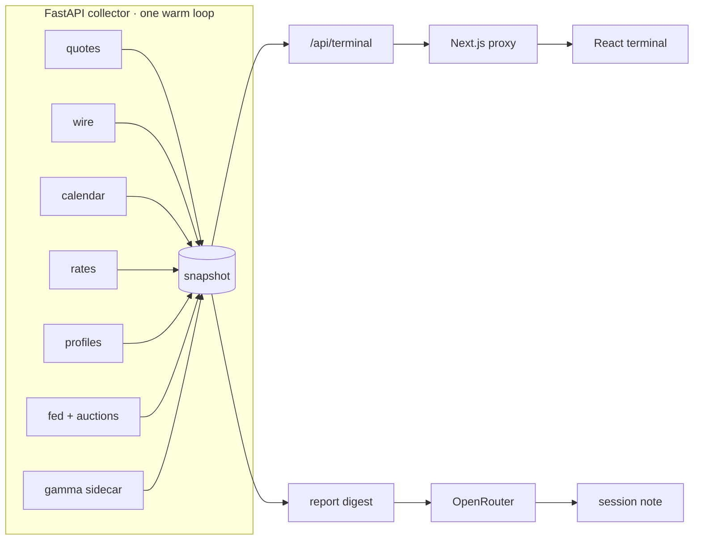

---

## Running it

Windows, Node 20+, Python 3.11+.

```powershell
npm install
cp .env.example .env.local     # add an OpenRouter key if you want session reports
.\dev.ps1                      # every half as a tab in one window, then the browser
npm run shortcut               # optional: the same thing, on the desktop
```

- Web: **http://localhost:3100** · Collector: **http://127.0.0.1:8100**
- `.\server\run.ps1` starts the collector alone — its window *is* the feed log: one
  row per source per refresh, with ages and item counts. Always start it through the
  script; it is what loads `.env.local`.
- The gamma panel reads a companion options service on `:8000`; without it, that one
  panel reports itself unavailable and everything else runs normally. `dev.ps1` will
  start that service too if it finds it beside this repo (or at `NT_GEXYGEN_HOME`) —
  a launch-time convenience only, skipped with `-NoGexygen`, and silent about every
  way it can be absent.
- Switches: `-Restart` (the collector again, in its own tab, rereading `.env.local` — how
  new Python code or a config edit goes live), `-Windows` (a window per half instead of
  tabs), `-CollectorOnly` (feeds, no web, no browser), `-NoBrowser`, `-Force`
  (start anyway, and clash), `-Prod` (the web half as a production build in
  `.next-prod` rather than `next dev` — lighter for a screen left open all day;
  `npm run prod` does the same by hand). Everything already listening is left alone, so a second
  run restarts nothing and is simply how you get the browser tab back.
- `npm run shortcut` puts a **HERMES** launcher on the desktop, winged helm and all,
  pointed at `dev.ps1`; `npm run shortcut:collector` adds a feed-only one beside it.
  The icon is `public/hermes.ico`, rendered from the same traced path as the header
  by `npm run icon` — re-run that only if the mark or its hues change. A shortcut made
  before the rename (2026-10-30) points at `hermesx.ico`, which no longer exists, so it
  shows a blank tile: run `npm run shortcut` again and delete the **HERMESX** one;
  `ie4uinit.exe -show` refreshes Explorer's icon cache if the old picture lingers.

Checks: `npm run check` runs TypeScript, ESLint, Ruff, mypy (strict) and the pytest
suite — 860 tests, most of them regression tests bought with a real observed bug:
the classifier rules, the FOMC un-mixing, the profile session windows, the
scanner's Pine port and its clock boundaries, the JSON
extractor's four observed wrappings. `npm test` runs the 13 TypeScript tests on
Hermes's router and prompt.

---

## Honest limitations

- **Personal-use data.** The quote and news sources here are free feeds that are fine
  to read at one desk and are **not redistributable**. This repository is published as
  code; if you deploy it for anyone but yourself, replace `server/newsterminal/sources/quotes.py`
  and `wire.py` with licensed sources first. That constraint shaped the design and is
  a feature of it, not an oversight.
- **Volume profiles are approximate** — built from 5-minute bars, labelled `≈` in the
  UI, and intended as context. Execution-grade profiles belong to tick data.
- **Yahoo's extended hours are partial.** Pre-market bars carry no volume (so relative
  volume starts at the open), and earlier days come back without their post-market
  beyond the 16:00 print — so the scanner's EMA wave skips the previous evening that
  TradingView, with extended hours on, would include. The four levels are unaffected.
- **The scanner's score is a heuristic rank**, not a probability — until the signal
  log has enough settled sessions to calibrate it.
- **The session-type lean is counts, not a model.** Two years of hourly bars, the
  label's thresholds the ladder's, every count printed beside its n; the session is
  the cash ETF's and gold's is read off GLD. The conditions were chosen by hand and
  the vote thresholds are a judgement, in-sample; the live log is what will say
  whether the lean earns its place, and it has only just begun.
- **The wide scan is fifteen minutes behind** on every row the live stream is not
  watching, and its levels are TradingView's, which can differ from the desk's own by a
  few cents and, on the pre-market low of a wick-heavy morning, by a percent or more.
  It finds names; a name traded from is a tracked name, on the desk's levels.
- **The heat map's lists are partial where the funds' are.** Yahoo names a fund's top ten
  and no more, six themes are hand-written lists (the five foreign-heavy ones and Oil & Gas
  E&P), and the stock table's
  1W is TradingView's own week, which can sit a couple of points from a strict five-session
  close (NVDA -10.7% against -8.8% on 2026-11-06).
- **The live stream is unofficial** and can change without notice. Nothing depends on it.
  `server/tools/stream_check.py` prints how it has compared with the bars, session by session.
- **Free-tier LLMs are flaky.** The report chain retries across models and modes,
  parses JSON out of four kinds of wrapper, and fails loudly with the full attempt
  trail when the pools are saturated.
- **Desktop-width layout** (≥1280px). It is a terminal; it assumes a monitor.

---

## The mark

The winged helm is my own line art. In the app it lives as a single traced vector
path (`src/lib/hermesMark.ts`), recoloured live to the terminal's chrome hues. The
icon reads that same file rather than copying it, and adds only what a wallpaper
does not supply: a chassis-black tile under the lockup's green-to-pink wash. The
browser tab and the desktop shortcut share that one `.ico`, so the launcher, the tab
it opens and the page inside it are one identity.
